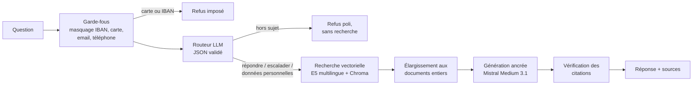

# Assistant RAG de support aux panélistes

> Un assistant qui répond aux questions des membres d'un panel consommateurs (application de scan,
> points, compte, RGPD) **à partir de la documentation seulement**. Il cite ses sources, dit quand
> il ne sait pas, refuse les données sensibles et passe la main à un humain quand il le faut.

**Toutes les données sont fictives** : l'entreprise « PanelConso », ses 27 documents et ses
86 questions d'évaluation ont été inventés pour ce projet. Aucune donnée réelle n'est utilisée.

## Ce que le projet démontre
- **Un pipeline RAG complet** : découpage, embeddings multilingues, base vectorielle, génération ancrée avec citations vérifiées.
- **Une évaluation rigoureuse** :
  - un jeu de dev pour régler, un jeu de test évalué **une seule fois** ;
  - une baseline et des intervalles de confiance ;
  - un LLM-juge validé contre des verdicts humains.
- **De la sécurité** : détection et masquage des données personnelles avant tout appel externe, routeur d'intention, escalade.
- **Du MLOps** :
  - expériences suivies dans MLflow ;
  - CI GitHub Actions avec des seuils de qualité bloquants ;
  - API FastAPI ;
  - image Docker reproductible.
- **Un raisonnement documenté** : 19 décisions argumentées ([docs/decisions.md](docs/decisions.md)) et une fiche par concept ([docs/concepts/](docs/concepts/)).

## Architecture


Une question suit ce trajet :
1. **Garde-fous.** Les données personnelles sont masquées avant tout appel au LLM. Un numéro de carte bancaire ou un IBAN entraîne un refus immédiat.
2. **Routage.** Un LLM classe l'intention : répondre, escalader, refuser une question hors sujet, ou refuser une demande de données personnelles.
3. **Recherche.** Les 5 passages les plus proches sont retrouvés, puis remplacés par leurs documents entiers, pour que le LLM ait tout le contexte.
4. **Génération.** Le LLM répond uniquement à partir de ces documents et cite chacun d'eux par son identifiant `[ID]`. Chaque citation est vérifiée par le code, et le LLM signale lui-même quand la documentation ne contient pas la réponse.

Le service s'utilise de deux façons :
- par l'**API FastAPI** (`POST /ask`) ;
- par l'**interface Streamlit**, qui appelle cette API par HTTP.

Les deux tournent dans la même image Docker.

## Résultats

Les chiffres de référence sont ceux du **jeu de test** : 19 questions, jamais utilisées pour régler le système, évaluées une seule fois ([D018](docs/decisions.md)). Ceux du dev, sur lequel le système a été réglé, sont donnés pour comparaison. Les intervalles de confiance sont des intervalles de Wilson à 95 %.

| Métrique | Dev (67 questions) | **Test (19 questions)** |
|---|---|---|
| Recall@5 de la recherche | 0,922 | **0,765** |
| MRR de la recherche | 0,862 | **0,649** |
| Routage (bonne action) | 0,955 [0,88 ; 0,98] | **0,789** [0,57 ; 0,91] |
| Fidélité aux sources (LLM-juge) | 0,985 [0,92 ; 1,00] | **0,842** [0,62 ; 0,94] |
| Correction des réponses | 0,940 [0,84 ; 0,98] | **0,692** [0,42 ; 0,87] |
| Bon comportement (refuser, escalader, ne pas inventer) | 0,667 à 1,000 | **1,000** |
| Citations inventées | 0 | **0** |

**Lecture :**
- **Le maillon faible est la recherche.** Les 3 réponses infidèles du test sont 3 cas où le bon document n'a pas été retrouvé : écart de vocabulaire (« supprimer mes données » face à « exercer vos droits ») et langage familier (« wesh jpeux scanner le pain »).
- **Les chiffres du dev étaient optimistes.** Les deux seules questions en langage familier sont tombées dans le test.
- **Avec 19 questions, l'incertitude reste forte**, comme le montre la largeur des intervalles.
- **Coût mesuré** : environ 0,09 $ par évaluation complète du dev (génération, routage et juge).

**Pistes essayées et écartées :**
- **Recherche hybride BM25 + vecteurs (RRF)** : recall@5 de 0,898, contre 0,922 pour la baseline vectorielle seule ([D009](docs/decisions.md), [D010](docs/decisions.md)).
- **Contexte limité aux passages** : il produisait des réponses venant de la mauvaise section, d'où le passage aux documents entiers ([D013](docs/decisions.md)).

## Stack technique
| Rôle | Outil |
|---|---|
| Orchestration | LangChain |
| Embeddings | `intfloat/multilingual-e5-small` (sentence-transformers, CPU) |
| Base vectorielle | Chroma |
| LLM (génération et routage) | Mistral Medium 3.1 via LiteLLM et OpenRouter |
| LLM-juge | Gemini 2.5 Flash, validé sur 13 cas annotés à la main |
| Suivi d'expériences | MLflow |
| Service | FastAPI, Streamlit |
| Tests et CI | pytest (63 tests, sans appel au LLM), GitHub Actions |
| Environnement | uv (versions verrouillées), Docker |

## Démarrage rapide

Prérequis : [uv](https://docs.astral.sh/uv/) et une clé [OpenRouter](https://openrouter.ai/).

```bash
uv sync                                   # installe Python 3.12 et les dépendances
cp .env.example .env                      # puis renseigner OPENROUTER_API_KEY
uv run python -m rag.ingestion            # construit l'index (data/chroma)
uv run uvicorn rag.api:app --port 8000    # API : http://localhost:8000/docs
uv run streamlit run app/streamlit_app.py # interface, dans un second terminal
```

**Avec Docker** (le modèle et l'index sont construits dans l'image, la clé est lue depuis `.env` au lancement) :
```bash
docker compose up --build
# interface : http://localhost:8510   API : http://localhost:8010/docs
docker compose down
```

**Exemple d'appel à l'API :**
```bash
curl -X POST http://localhost:8000/ask -H "Content-Type: application/json" \
     -d '{"question": "How long are my points valid?"}'
```

**Tests et évaluation :**
```bash
uv run pytest                                          # tests unitaires, sans LLM
uv run python scripts/validate.py                      # cohérence du corpus et des questions
uv run python scripts/eval_retrieval.py                # recall@k et MRR (gratuit)
uv run python scripts/eval_e2e.py --split dev --check  # bout en bout + seuils (~0,09 $)
uv run mlflow ui --backend-store-uri sqlite:///mlflow.db  # résultats : http://localhost:5000
```

## Structure du projet
```
corpus/            27 documents Markdown fictifs, avec frontmatter (id, titre, catégorie...)
eval/              86 questions annotées (67 dev, 19 test) et verdicts humains pour le juge
src/rag/           le package : ingestion, retrieval, generation, guardrails, router,
                   pipeline, judge, evaluation, api, config (tous les réglages, justifiés)
app/               interface Streamlit et son client HTTP
scripts/           évaluations (recherche, génération, routage, juge, bout en bout)
tests/             tests pytest, un fichier par module
docs/concepts/     une fiche par concept (idée, fonctionnement, choix, limites, entretien)
docs/decisions.md  journal des décisions D001 à D019 : contexte, options, choix, mesure
.github/workflows/ tests.yml (chaque push) et eval.yml (pull request, seuils bloquants)
```

### Jeu d'évaluation
Chaque ligne de `eval/questions.jsonl` décrit une question :

| Champ | Valeurs |
|---|---|
| `type` | factuelle, multi_docs, piege_invention, hors_sujet, securite_donnees, escalade |
| `style` | standard, familier, fautes, anglais |
| `categorie` | catégorie de routage attendue |
| `comportement` | repondre, repondre_sans_inventer, refuser, escalader |
| `sources` | identifiants des documents à retrouver |
| `reponse_attendue` | éléments clés que la réponse doit contenir |
| `split` | dev (réglage) ou test (évaluation finale) |

## Limites
- **La recherche ne résiste pas au langage familier ni aux écarts de vocabulaire.** C'est la première cause d'erreur mesurée sur le test.
- **Le jeu de test est petit (19 questions) et désormais « consommé ».** Toute amélioration future demande un nouveau jeu de test.
- **Le routeur escalade trop souvent** sur le test (3 cas), alors que la personne pouvait résoudre sa demande seule.
- **Il n'y a pas de mémoire de conversation** : chaque question est traitée isolément.
- **L'API n'a ni authentification ni limitation de débit**, à ajouter avant toute mise en ligne publique.
- **Le corpus est figé dans l'image Docker**, qui pèse 4 Go, surtout à cause de torch et du modèle d'embeddings.
- **Le LLM-juge est une mesure imparfaite** : son accord avec les verdicts humains (97 %, sur 36 verdicts de 13 cas) est optimiste, car sa grille a été réglée sur ces mêmes cas.

## Améliorations envisagées
1. **Améliorer la recherche** par un reranking (cross-encoder) ou une reformulation de la question avant la recherche.
2. **Agrandir le jeu d'évaluation** à 150 à 200 questions, avec plus de langage familier et un nouveau jeu de test.
3. **Revoir la règle anti-escalade du routeur.**
4. **Déployer une démo publique** (Hugging Face Spaces) avec un quota de questions.
