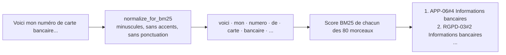

# Recherche lexicale BM25

## 1. L'idée en une phrase
BM25 classe les morceaux selon les **mots** qu'ils partagent avec la question, en donnant
plus de poids aux mots rares et en évitant qu'un mot répété dix fois compte dix fois plus.

## 2. Explication simple
C'est l'index à la fin d'un livre, en plus malin. Si tu cherches « carte bancaire E302 »,
les pages qui contiennent « E302 » (mot rare, presque une signature) comptent beaucoup plus
que celles qui contiennent « carte » (mot courant). Et une page qui répète « carte » 15 fois
n'est pas 15 fois plus pertinente qu'une page qui le dit une fois.

BM25 ne comprend rien au sens : « I forgot my password » ne partage aucun mot avec
« Mot de passe oublié ». En revanche, il ne rate jamais un terme exact (code d'erreur, nom
de produit, numéro), là où les embeddings sont flous.

## 3. Comment ça marche techniquement
Pour chaque mot $m$ de la question $Q$ et chaque morceau $D$ :

$$
\text{score}(D, Q) = \sum_{m \in Q} \mathrm{IDF}(m) \cdot \frac{f(m, D)\,(k_1 + 1)}{f(m, D) + k_1 \left(1 - b + b \,\dfrac{|D|}{\text{longueur moyenne}}\right)}
$$

- $\mathrm{IDF}(m)$ (*inverse document frequency*) : grand si le mot est rare dans le corpus.
  Dans `rank-bm25` : $\mathrm{IDF}(m) = \ln\dfrac{N - n(m) + 0{,}5}{n(m) + 0{,}5}$, avec $N$ le
  nombre de morceaux et $n(m)$ le nombre de morceaux contenant $m$.
- $f(m, D)$ : nombre d'occurrences du mot dans le morceau, avec **saturation** réglée par
  $k_1 \approx 1{,}5$ : la 2e occurrence rapporte moins que la 1re, la 10e presque rien.
- $b \approx 0{,}75$ : normalisation par la longueur $|D|$, pour ne pas favoriser les longs morceaux.

Tout dépend du **découpage en mots** (*tokenization*) : BM25 compare des chaînes à
l'identique. « Données », « données. » et « donnees » sont trois mots différents si on ne
les normalise pas.

## 4. Comment c'est implémenté dans ce projet
- `src/rag/retrieval.py`
  - `normalize_for_bm25()` : minuscules, suppression des accents (décomposition Unicode
    NFKD puis retrait des diacritiques), découpage en mots avec `\w+`.
  - `load_chunks_from_store()` : relit les 80 morceaux depuis Chroma, pour que BM25 et la
    recherche vectorielle portent exactement sur les mêmes morceaux.
  - `get_bm25_retriever()` : `BM25Retriever.from_documents(...)` de LangChain (qui utilise
    `rank-bm25`, paramètres par défaut $k_1 = 1{,}5$, $b = 0{,}75$), construit en mémoire.
- `tests/test_retrieval.py` : normalisation, et une recherche sans accents qui retrouve la
  bonne section.

**Résultat mesuré (dev, 62 questions)** : BM25 seul atteint recall@5 = **0,796** et
MRR = **0,728**, contre 0,922 et 0,862 pour la recherche vectorielle.

## 5. Choix faits et alternatives écartées
| Option | Statut | Commentaire |
|---|---|---|
| `BM25Retriever` (LangChain) + `rank-bm25` | retenu | Standard, s'insère dans `EnsembleRetriever` |
| Prétraitement : minuscules + accents + ponctuation | retenu | Indispensable ; le défaut LangChain est un simple `split()` |
| Mots vides français (« le », « est », « que »...) | **retenu** (D010) | ~80 mots, négations gardées ; c'est le plus gros gain |
| Racinisation Snowball (*stemming*, « bancaires » → « bancair ») | **retenu** (D010) | Dépendance `snowballstemmer` ; appliquée après la suppression des accents |

**Résultat de l'analyseur français** (`BM25_ANALYZER = "french"`) : BM25 seul passe de
recall@5 0,796 à **0,884** et de MRR 0,728 à **0,789**. Limite observée : Snowball laisse
« expirent » intact, donc la correspondance « expirent / expiration » n'est **pas** résolue ;
l'amélioration sur cette question vient de la suppression des mots vides.

**`rank-bm25` ou `BM25Retriever` ?** Deux couches : `rank_bm25.BM25Okapi` calcule les scores
sur des listes de mots, sans rien connaître d'autre ; `BM25Retriever` (LangChain) l'appelle
en ajoutant le stockage des `Document` (métadonnées), le crochet `preprocess_func` (où l'on
branche l'analyseur) et l'interface retriever `.invoke()`, qui le rend compatible avec
`EnsembleRetriever`.
| Index BM25 persistant (Elasticsearch, OpenSearch) | écarté | Disproportionné pour 80 morceaux reconstruits en millisecondes |

**Risque de maintenance** : `langchain-community`, qui contient `BM25Retriever`, est
annoncé en fin de vie par LangChain. Si nécessaire, le remplacer par `rank_bm25` utilisé
directement représente une quinzaine de lignes.

## 6. Limites et pièges connus (observés sur ce projet)
- **Pas de racinisation** : Q005 « Est-ce que mes points expirent ? » ne retrouve pas
  REC-05, dont le titre est « **Expiration** des points » : pour BM25, « expirent » et
  « expiration » n'ont rien en commun.
- **Mots vides** : sur cette même question, le top 5 de BM25 est rempli de morceaux qui ne
  partagent que « est », « ce », « que », « mes » avec elle.
- **Synonymes et langues** : « réseau » vs « hors ligne » (Q017), anglais vs français (Q080) :
  aucun mot commun, aucun résultat. BM25 seul obtient 0 en recall@1 sur les 3 questions en anglais.
- **Force réelle, confirmée** : sur Q068 (« carte bancaire »), BM25 place `RGPD-03#2`
  « Informations bancaires » en 2e position, alors que la recherche vectorielle ne le met
  même pas dans son top 10.

## 7. Pour l'entretien
**30 secondes** : « BM25, c'est la recherche par mots-clés moderne : un score qui favorise
les mots rares, sature les répétitions et normalise la longueur. Il est imbattable sur les
termes exacts, comme les codes d'erreur, mais aveugle au sens et aux synonymes. Sur mon
corpus français, le prétraitement change tout : 0,80 de recall@5 avec un simple découpage,
0,88 avec mots vides et racinisation, contre 0,92 pour l'embedding. »

**2 minutes** : la formule (IDF, saturation $k_1$, normalisation $b$), l'importance de la
tokenization (et le piège du `split()` par défaut), puis l'analyse d'erreurs : succès sur
« carte bancaire », échecs sur « expirent/expiration » et sur les mots vides, avec les
remèdes (mots vides, racinisation) et le coût de chacun.

**Questions probables**
1. *Pourquoi BM25 alors qu'on a des embeddings ?* → Complémentarité : correspondances
   exactes (codes, noms propres, chiffres) que les embeddings lissent.
2. *Que font $k_1$ et $b$ ?* → Saturation des répétitions ; normalisation par la longueur.
3. *Pourquoi vos résultats BM25 sont-ils faibles ?* → Français sans racinisation ni mots
   vides, questions courtes et familières, corpus minuscule (IDF peu discriminant).
4. *BM25 en production ?* → Elasticsearch / OpenSearch, avec analyseurs de langue
   (mots vides, racinisation) intégrés.
