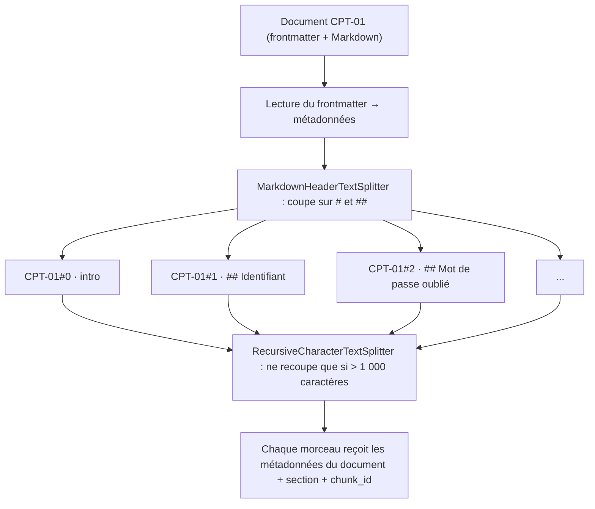

# Chunking (découpage des documents)

## 1. L'idée en une phrase
On découpe chaque document en morceaux (*chunks*) assez petits pour ne parler que d'un
sujet, mais assez complets pour être compris seuls, parce que c'est le morceau, pas le
document, qui sera retrouvé et donné au LLM.

## 2. Explication simple
Imagine un classeur de procédures. Si tu indexes le classeur entier comme un seul bloc, la
recherche te répond « c'est dans le classeur » : vrai, mais inutile. Si tu indexes chaque
phrase, tu retrouves « Attendez 30 minutes » sans savoir de quoi il s'agit. Le bon grain,
c'est la fiche : un sujet, avec son titre. Ici, les documents sont déjà rédigés en fiches :
chaque section « ## » traite d'un seul sujet (« Mot de passe oublié », « Compte bloqué »).

## 3. Comment ça marche techniquement
Deux familles de découpage :

- **Par taille** : on coupe tous les N caractères (ou tokens), avec un chevauchement pour
  ne pas couper une idée en deux. Simple, aveugle à la structure.
- **Par structure** : on coupe sur les frontières du document (titres Markdown, paragraphes,
  balises HTML). Respecte le sens, mais la taille des morceaux varie.

Ce projet combine les deux : d'abord par structure, puis par taille en filet de sécurité.

La **taille maximale** est bornée par le modèle d'embeddings : E5 lit au plus 512 tokens et
tronque le reste sans prévenir. 1 000 caractères ≈ 250 tokens en français : marge confortable.

## 4. Comment c'est implémenté dans ce projet
- `src/rag/ingestion.py`
  - `parse_markdown_file()` : sépare le frontmatter (`id`, `titre`, `categorie`,
    `version`, `date_maj`) du corps.
  - `load_corpus()` : un `Document` LangChain par fichier, avec le chemin `source`.
  - `split_into_chunks()` : `MarkdownHeaderTextSplitter` puis
    `RecursiveCharacterTextSplitter` ; chaque morceau hérite des métadonnées du document et
    reçoit `section` et un `chunk_id` stable (`CPT-01#2`).
- `src/rag/config.py` : `HEADERS_TO_SPLIT_ON`, `CHUNK_SIZE = 1000`, `CHUNK_OVERLAP = 100`,
  avec leur justification.
- `tests/test_ingestion.py` : découpage d'un document exemple, couverture des 27 documents,
  unicité des identifiants, taille maximale respectée.

**Résultat mesuré sur le corpus** : 27 documents → **80 morceaux** ; 1 à 6 morceaux par
document ; taille de 48 à 750 caractères, médiane 166. Le découpage par taille ne se
déclenche sur aucun morceau (tous < 1 000 caractères). 10 morceaux font moins de 100
caractères.

## 5. Choix faits et alternatives écartées
| Option | Pour | Contre |
|---|---|---|
| **Par section Markdown** (retenu) | Suit les frontières de sens déjà posées par les rédacteurs ; métadonnée `section` gratuite | Morceaux très courts, parfois privés de contexte |
| Document entier | Contexte complet, 27 morceaux seulement | Un document mélange plusieurs sujets : son vecteur est une « moyenne » moins précise |
| Taille fixe (ex. 500 caractères) | Uniforme, indépendant du format | Coupe au milieu d'une section, mélange deux sujets dans un morceau |
| Découpage sémantique (coupe là où le sens change, via embeddings) | Adapté aux textes sans structure | Plus lent, moins prévisible ; inutile quand la structure existe |

**Chevauchement (overlap)** : utile pour le découpage par taille (une phrase coupée reste
lisible des deux côtés). Avec un découpage par section, il ne joue que si une section
dépasse 1 000 caractères, ce qui n'arrive pas aujourd'hui.

## 6. Limites et pièges connus
- **Perte de contexte des petits morceaux** (observé ici) : `CPT-05#2` contient seulement
  « ## ScanBox / Renvoyez-la sous 30 jours avec l'enveloppe prépayée ». Rien dans le texte
  ne dit qu'il s'agit de *quitter le panel* : cette information est dans les métadonnées,
  que l'embedding ne voit pas. Une question « je quitte le panel, je fais quoi de la
  ScanBox ? » risque de remonter la fiche ScanBox générale (APP-10) plutôt que celle-ci.
  Remède classique : préfixer chaque morceau par le titre du document (*contextual chunk
  header*). À mesurer en phase 2 avant de l'adopter.
- **Questions à cheval sur deux sections** : il faut les deux morceaux dans le top k.
- **Mesurer plutôt que deviner** : la taille idéale dépend du corpus et des questions ; on
  la valide par le recall@k, pas par intuition.
- **Tableaux, listes longues** : un découpage par taille peut les casser en morceaux illisibles.

## 7. Pour l'entretien
**30 secondes** : « Je découpe par section Markdown, parce que chaque section de la
documentation traite d'un seul sujet ; chaque morceau garde les métadonnées de son document
pour la citation et le filtrage. Un second découpage par taille, à 1 000 caractères, protège
contre une section trop longue pour le modèle d'embeddings. »

**2 minutes** : le compromis précision / contexte (trop gros = vecteur flou, trop petit =
morceau incompréhensible), les deux familles (taille / structure), la contrainte des 512
tokens du modèle, les chiffres du corpus (80 morceaux, médiane 166 caractères), et la
limite observée sur les petits morceaux avec la piste du titre en préfixe, à valider par la
mesure.

**Questions probables**
1. *Comment avez-vous choisi la taille des chunks ?* → Structure du corpus d'abord, borne
   du modèle ensuite (512 tokens), puis validation par le recall@k.
2. *À quoi sert l'overlap ?* → Ne pas couper une idée à la frontière entre deux morceaux ;
   peu utile ici puisqu'on coupe sur les titres.
3. *Quel est le risque des petits chunks ?* → Perte de contexte (exemple CPT-05#2) ; remède :
   titre du document en préfixe, ou récupérer la section voisine (*parent document retrieval*).
4. *Pourquoi garder les métadonnées sur chaque chunk ?* → Citer la source, filtrer par
   catégorie, afficher la version et la date de mise à jour.
