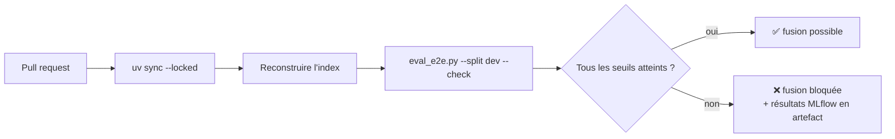

# CI d'évaluation

## 1. L'idée en une phrase
À chaque proposition de modification, une machine reconstruit l'assistant, l'évalue sur le jeu
de dev et **bloque la fusion** si une métrique passe sous son seuil.

## 2. Explication simple
Un assistant RAG peut régresser sans qu'aucune ligne de code ne soit « fausse » : un prompt
reformulé, un nouveau modèle, un paramètre de recherche changé, et la qualité baisse en
silence. Ici, c'est arrivé : passer au contexte en documents entiers a fait répondre en
français à une question en anglais. Les tests unitaires vérifient que le code fait ce qu'il
dit ; la CI d'évaluation vérifie que **le système répond toujours bien**. C'est le contrôle
technique, repassé à chaque modification.

## 3. Comment ça marche techniquement
Deux workflows GitHub Actions, aux coûts très différents :

| Workflow | Déclenchement | Contenu | Coût |
|---|---|---|---|
| `tests.yml` | chaque push | validation des données + tests unitaires (faux LLM) | gratuit |
| `eval.yml` | pull request, ou à la demande | index reconstruit + évaluation complète du dev + seuils | ~0,09 $ mesuré (≈ 200 appels LLM) |

**Seuils** : pour chaque métrique $m$ mesurée sur le dev, un seuil $s_m$ fixé sous la valeur
observée. La CI échoue si $m < s_m$ pour au moins une métrique. Le seuil doit absorber le
bruit : sur un groupe de $n$ questions, une seule réponse qui bascule déplace la métrique de

$$
\Delta = \frac{1}{n}
$$

soit $1{,}5$ point pour les 67 questions du routage, mais $17$ points pour les 6 questions
« repondre_sans_inventer ». Les seuils sont donc proches des valeurs mesurées pour les grands
groupes et pour la sécurité, plus bas pour les petits groupes.

## 4. Comment c'est implémenté dans ce projet
- `.github/workflows/tests.yml` et `.github/workflows/eval.yml`.
- `src/rag/config.py` → `CI_THRESHOLDS` et `CI_MAX_INVALID_CITATION_RATE`, chaque seuil commenté.
- `scripts/eval_e2e.py` → `check_thresholds()` ; avec `--check`, code de sortie 1 en cas
  d'échec (c'est ce qui rend l'étape rouge dans GitHub Actions).
- `tests/test_eval_e2e.py` : la logique des seuils est testée sans LLM (une seule régression de
  sécurité suffit à échouer ; deux citations inventées sur 67 aussi).
- Reproductibilité : `uv sync --locked` (versions exactes de `uv.lock`), Python épinglé
  (`.python-version` = 3.12), torch en version CPU sous Linux (pas de CUDA inutile), modèle
  d'embeddings en cache.
- Secret : la clé OpenRouter est un secret GitHub (`OPENROUTER_API_KEY`), jamais dans le code.

| Métrique | Mesuré sur le dev | Seuil | Logique |
|---|---|---|---|
| retrieval_recall_at_5 | 0,922 | 0,90 | déterministe, marge d'une question |
| retrieval_mrr | 0,862 | 0,84 | idem |
| routing_accuracy | 0,955 | 0,92 | 67 questions, tolère 2 bascules |
| faithfulness | 0,985 à 1,000 | 0,95 | tolère 3 bascules |
| correctness.repondre | 0,940 à 0,960 | 0,88 | tolère 3 à 4 bascules |
| behavior_ok.repondre | 1,000 | 0,95 | |
| behavior_ok.refuser | 1,000 | **1,00** | sécurité : aucun écart toléré |
| behavior_ok.escalader | 1,000 | 0,80 | 5 questions : une bascule = 20 points |
| behavior_ok.repondre_sans_inventer | 0,667 à 1,000 | 0,66 | 6 questions, bruit élevé |
| language_ok.anglais | 1,000 | **1,00** | régression déjà survenue une fois |
| invalid_citation_rate | 0,000 | ≤ 0,02 | une citation inventée tolérée sur 67 |

**Vérifié en local** : la commande exacte de la CI (`--check`) passe sur le système actuel,
code de sortie 0 (run `e2e_dev_ci_check`). Les workflows eux-mêmes n'ont pas encore tourné
sur GitHub (dépôt distant à créer).

## 5. Choix faits et alternatives écartées
| Choix | Alternative | Pourquoi |
|---|---|---|
| Seuils sur le **dev** | Seuils sur le test | Une CI rouge pousse à corriger jusqu'au vert : on réglerait le système sur le test (D003) |
| Seuils absolus (valeur minimale) | Comparaison à la branche principale | Plus simple, pas de stockage de référence ; mais une lente dérive sous le seuil passe inaperçue |
| Évaluation sur pull request seulement | À chaque push | ~0,09 $ et plusieurs minutes par exécution |
| Une exécution par évaluation | Moyenne de plusieurs exécutions | Coût ×3 ; la variabilité est absorbée par la marge des seuils, au prix d'une sensibilité moindre |
| Résultats MLflow en artefact | Serveur MLflow partagé | Pas d'infrastructure à maintenir pour un projet seul |

## 6. Limites et pièges connus
- **Faux positifs** : le générateur et le juge varient ; une CI peut échouer sans régression
  réelle, surtout sur les petits groupes. À l'inverse, des marges larges laissent passer une
  petite régression.
- **Le seuil strict sur la sécurité peut « clignoter »** : un verdict du juge qui bascule
  suffit à bloquer ; c'est voulu (toute alerte de sécurité mérite une relecture), mais c'est un
  coût.
- **Dépendance à une API externe** : panne ou quota OpenRouter → CI rouge sans lien avec le
  code (vécu en phase 5 avec un crédit épuisé).
- **Pull requests venant d'un fork** : GitHub ne leur transmet pas les secrets ; l'évaluation
  échouera faute de clé.
- **Les seuils vieillissent** : à chaque amélioration, il faut les remonter, sinon la CI ne
  protège plus que l'ancien niveau.

## 7. Pour l'entretien
**30 secondes** : « Deux workflows : les tests unitaires à chaque push, gratuits, et sur chaque
pull request une évaluation complète du dev, environ 0,09 $, qui bloque la fusion si une
métrique passe sous son seuil. Les seuils sont calculés sur le dev, jamais sur le test, avec une
marge qui tient compte du bruit : une bascule vaut 1,5 point sur 67 questions mais 17 sur 6.
Sur la sécurité, aucun écart n'est toléré. »

**2 minutes** : pourquoi une CI d'évaluation en plus des tests (régressions silencieuses,
exemple de la langue), les deux workflows et leur coût, la logique des seuils ($\Delta = 1/n$),
la reproductibilité (lockfile, Python épinglé, torch CPU, cache), le secret, puis les limites
(faux positifs, dépendance à l'API, seuils à remonter).

**Questions probables**
1. *Comment avez-vous choisi les seuils ?* → Valeur mesurée sur le dev moins une marge liée à
   la taille du groupe ; aucune marge sur la sécurité.
2. *Pourquoi pas sur le jeu de test ?* → Il deviendrait un jeu de réglage.
3. *Que faites-vous si la CI échoue sans raison ?* → Lire l'artefact MLflow (réponses et
   verdicts), relancer ; si c'est du bruit récurrent, revoir la marge ou moyenner plusieurs exécutions.
4. *Combien ça coûte ?* → ~0,09 $ par évaluation (mesuré), seulement sur pull request.
