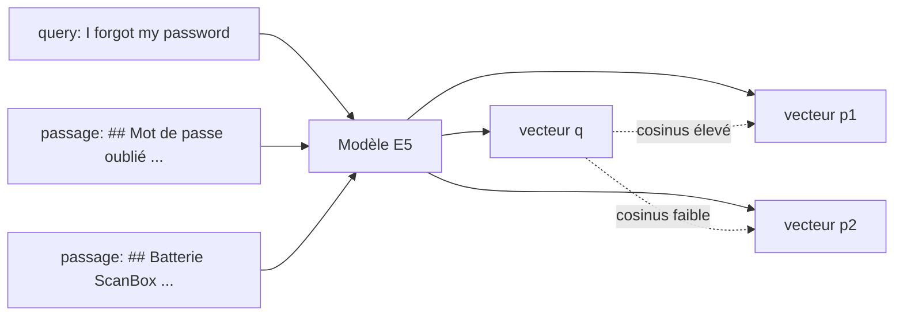

# Embeddings

## 1. L'idée en une phrase
Un embedding transforme un texte en une liste de nombres (un vecteur) telle que deux
textes de **sens proche** donnent deux vecteurs **proches**.

## 2. Explication simple
Imagine une carte où chaque phrase est une ville. Le modèle d'embeddings place les villes
de sorte que « J'ai oublié mon mot de passe », « jai pa recu le mail pour le mot de pass »
et « I forgot my password » soient dans le même quartier, alors que « Ma ScanBox ne
s'allume plus » est à l'autre bout de la carte. Chercher un passage pertinent revient
alors à chercher les villes les plus proches de celle de la question.

La différence avec une recherche par mots-clés : la carte est construite sur le **sens**.
« Identifiant » et « login » n'ont aucune lettre en commun mais atterrissent près l'un de
l'autre.

## 3. Comment ça marche techniquement
- Un modèle de type **Transformer** (ici un encodeur de la famille BERT) lit le texte
  découpé en *tokens* et produit un vecteur par token ; on en fait la moyenne (*mean
  pooling*) pour obtenir **un vecteur de 384 dimensions** pour tout le texte.
- Le modèle a été entraîné par **apprentissage contrastif** : on lui montre des paires
  (question, passage qui y répond) et on le pousse à rapprocher leurs vecteurs tout en
  éloignant ceux des passages non pertinents.
- La proximité se mesure par la **similarité cosinus** (le cosinus de l'angle entre deux
  vecteurs) :

  $$
  \cos(q, p) = \frac{q \cdot p}{\|q\|\,\|p\|} = \frac{\sum_{j=1}^{384} q_j\, p_j}{\sqrt{\sum_j q_j^2}\,\sqrt{\sum_j p_j^2}}
  $$

  Si on normalise les vecteurs à une longueur de 1 ($\|q\| = \|p\| = 1$), le cosinus devient
  un simple produit scalaire : $\cos(q, p) = q \cdot p$.
- **Préfixes E5** : la famille E5 a été entraînée avec `query: ` devant les questions et
  `passage: ` devant les documents. Une question est courte et interrogative, un passage
  est long et affirmatif : ce ne sont pas des textes de même nature (recherche
  *asymétrique*), et le préfixe dit au modèle lequel il encode.

## 4. Comment c'est implémenté dans ce projet
- `src/rag/config.py` : `EMBEDDING_MODEL`, `QUERY_PREFIX`, `PASSAGE_PREFIX`.
- `src/rag/embeddings.py` → `get_embeddings()` : un `HuggingFaceEmbeddings` (LangChain)
  qui fait tourner le modèle en local via sentence-transformers. `encode_kwargs` s'applique
  aux passages (`embed_documents`), `query_encode_kwargs` aux questions (`embed_query`).
- `tests/test_embeddings.py` vérifie : 384 dimensions, norme 1, préfixes bien appliqués
  (même texte → vecteurs différents selon qu'il est question ou passage), et qu'une question
  en anglais est plus proche du bon passage français que d'un passage hors sujet.

## 5. Choix faits et alternatives écartées
| Modèle | Taille | Pour | Contre |
|---|---|---|---|
| **multilingual-e5-small** (retenu) | 118 M, 384 dim | Multilingue, entraîné pour question → passage, tourne sur CPU | Moins précis que les gros modèles |
| bge-m3 | 568 M, 1024 dim | Meilleur sur les benchmarks multilingues | ~5× plus lourd, lent sur CPU, gros pour un hébergement gratuit |
| paraphrase-multilingual-MiniLM | 118 M | Léger | Entraîné pour comparer deux phrases de même nature, pas question → passage |
| API d'embeddings (Mistral, NVIDIA...) | - | Rien à héberger | Coût, latence réseau, dépendance ; les documents sortent de la machine |

Le choix se justifie par le corpus (français, questions parfois en anglais) et par le
déploiement visé (CPU gratuit). Si le recall mesuré en phase 2 est décevant, bge-m3 est la
première expérience à mener.

## 6. Limites et pièges connus
- **Oublier les préfixes E5** : pas d'erreur, juste une recherche silencieusement dégradée.
- **Changer de modèle impose de tout ré-indexer** : les vecteurs de deux modèles ne sont
  pas comparables entre eux.
- **Troncature** : au-delà de 512 tokens, le texte est coupé sans prévenir ; d'où des
  morceaux courts (voir chunking).
- Les embeddings sont **mauvais sur les correspondances exactes** : un code d'erreur
  « E302 » ou un nombre « 1 500 points » n'a pas de « sens » ; c'est là que la recherche
  lexicale (BM25) aide.
- Deux phrases de sens **opposé** (« je peux » / « je ne peux pas ») peuvent être très proches.

## 7. Pour l'entretien
**30 secondes** : « Un embedding, c'est un vecteur qui représente le sens d'un texte :
deux textes proches en sens ont des vecteurs proches. J'utilise multilingual-e5-small, un
petit modèle local qui marche en français et en anglais, avec les préfixes query/passage
qu'il attend, et des vecteurs normalisés pour que la similarité soit un cosinus. »

**2 minutes** : expliquer l'encodeur + mean pooling, l'entraînement contrastif sur des
paires question/passage, la recherche asymétrique et les préfixes, puis le choix du modèle
(tableau section 5) avec ses compromis taille / qualité / hébergement, et la limite sur les
codes et les nombres qui motive la recherche hybride.

**Questions probables**
1. *Comment avez-vous choisi le modèle ?* → Langue du corpus, asymétrie question/passage,
   contrainte CPU ; on mesure le recall et on garde bge-m3 comme alternative.
2. *Pourquoi normaliser ?* → Le produit scalaire devient le cosinus ; les distances L2 et
   cosinus donnent alors le même classement, peu importe celle qu'utilise la base vectorielle.
3. *Que se passe-t-il si vous changez de modèle ?* → Ré-indexation complète obligatoire.
4. *Où les embeddings échouent-ils ?* → Codes, nombres, noms propres, négations ; d'où BM25.
5. *Embeddings locaux ou API ?* → Local : gratuit, pas de fuite de données, pas de latence
   réseau ; API : pas d'infra, souvent meilleurs modèles.
