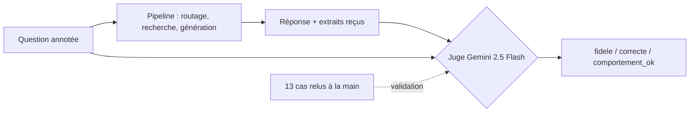

# Évaluation de la génération : fidélité, LLM-as-judge et ses limites

## 1. L'idée en une phrase
Pour juger des centaines de réponses en texte libre, on fait lire chaque réponse par un second
LLM (le « juge ») qui applique une grille précise, puis on vérifie ce juge contre des
verdicts humains avant de croire ses chiffres.

## 2. Explication simple
Les métriques de recherche (recall@k) disent si le LLM avait les bons documents. Elles ne
disent pas si sa réponse est **juste** : il peut avoir le bon extrait sous les yeux et en
tirer une conclusion fausse. Relire 67 réponses à la main à chaque modification est
impossible ; un correcteur automatique est donc nécessaire.

C'est comme faire corriger des copies par un assistant : il va vite, mais il faut lui donner
un barème très précis, vérifier sur quelques copies qu'il note comme vous, et garder en tête
qu'il se trompera parfois, surtout sur les cas subtils.

## 3. Comment ça marche techniquement
Le juge reçoit, pour chaque question : la question, le comportement attendu, les éléments clés
de la réponse attendue, **les extraits que le générateur a reçus**, et la réponse. Il rend trois
verdicts binaires :

| Verdict | Question posée | Ce qu'il détecte |
|---|---|---|
| **fidele** | Chaque information factuelle est-elle écrite dans les extraits ? | Hallucinations, déductions abusives |
| **correcte** | Les éléments clés attendus sont-ils présents, sans contradiction ? | Réponses incomplètes ou fausses |
| **comportement_ok** | Répondre / ne pas inventer / refuser / escalader, comme attendu ? | Erreurs de routage visibles par l'utilisateur |

Sur $n$ réponses jugées, chaque métrique est une simple proportion, par exemple :

$$
\text{fidélité} = \frac{1}{n} \sum_{i=1}^{n} \mathbb{1}[\text{fidele}_i]
$$

**Verdicts binaires plutôt qu'une note de 1 à 5** : un LLM tranche « oui / non » de façon bien
plus stable qu'il ne distingue un 3 d'un 4, et une proportion se lit directement.

**Fidélité ≠ correction** : une réponse peut être fidèle et incorrecte (Q075 : tout ce qu'elle
dit est dans les extraits, mais elle omet l'expiration des points), ou correcte en apparence
et infidèle (elle dit le vrai par chance, sans appui dans les extraits).

**Valider le juge (méta-évaluation)** : on compare ses verdicts à des verdicts humains sur des
cas relus à la main, et on mesure le taux d'accord :

$$
\text{accord} = \frac{\#\{\text{verdicts où juge} = \text{humain}\}}{\#\{\text{verdicts humains}\}}
$$

## 4. Comment c'est implémenté dans ce projet
- `src/rag/judge.py`
  - `JUDGE_PROMPT` : la grille, avec une définition précise de chaque verdict.
  - `Verdict` (pydantic) ; `parse_verdict()` : verdict illisible → `erreur_juge`, exclu des
    métriques et compté à part.
  - `judge_answer()` : un appel au juge par réponse.
- `src/rag/config.py` : `JUDGE_MODEL = "openrouter/google/gemini-2.5-flash"` (autre famille que
  le générateur Mistral, pour limiter le biais d'auto-préférence), température 0.
- `eval/judge_labels.jsonl` : 13 cas relus à la main (36 verdicts), tirés des runs des phases 4 et 5.
- `scripts/validate_judge.py` : taux d'accord juge / humain, liste des désaccords.
- `scripts/eval_e2e.py` : pipeline complet + juge sur un split, métriques par comportement,
  enregistrement MLflow (expérience `e2e`), option `--check` pour la CI.
- `src/rag/evaluation.py` → `detect_language()` : contrôle déterministe de la langue des
  réponses aux questions en anglais (voir limites).

### Validation du juge (13 cas, 36 verdicts humains)
| Version de la grille | fidele | correcte | comportement_ok | Accord global |
|---|---|---|---|---|
| v1 | 11/13 | 12/13 | 8/10 | **86 %** |
| v2 (précisée) | 12/13 | 13/13 | 10/10 | **97 %** (optimiste : grille réglée sur ces mêmes cas) |

Les désaccords de la v1 montraient un juge qui **mélange les critères** : il déclarait fidèle
une déduction qu'il jugeait lui-même fausse (Q009), et pénalisait une omission au titre de la
fidélité (Q075). La v2 précise que chaque verdict ne juge qu'un critère.

### Résultats de bout en bout (dev, 67 questions, 3 exécutions)
| Métrique | e2e_dev_v1 | e2e_dev_v2 | e2e_dev_ci_check |
|---|---|---|---|
| fidélité | 1,000 | 1,000 | 0,985 |
| correction (« repondre ») | 0,940 | 0,960 | 0,940 |
| comportement « repondre_sans_inventer » (6 questions) | 1,000 | 0,667 | 0,667 |
| langue des réponses aux questions en anglais (3) | — | 1,000 | 1,000 |

Coût mesuré : environ 0,09 $ par évaluation complète (génération + juge), déduit de la
consommation OpenRouter.

### Évaluation finale sur le jeu de test (19 questions, une seule exécution, D018)
| Métrique | Dev | Test | IC 95 % (test) |
|---|---|---|---|
| fidélité | 0,985 | **0,842** | [0,62 ; 0,94] |
| correction (« repondre ») | 0,940 | **0,692** | [0,42 ; 0,87] |
| comportements attendus | 0,667 à 1,000 | 1,000 | |

Les 3 réponses jugées infidèles du test correspondent aux 3 questions dont le bon document n'a
pas été retrouvé : **la fidélité de la génération dépend d'abord de la recherche**. Les chiffres
du dev étaient optimistes ; ceux du test sont l'estimation à présenter, avec leur incertitude.

**Erreurs réelles attrapées par le juge** :
- Q051 « J'ai quitté le panel il y a deux mois et demi, je peux encore utiliser mes points ? » →
  « **Oui**, […] pendant 60 jours » : raisonnement faux (deux mois et demi > 60 jours), jugé incorrect.
- Q045 (run e2e_dev_ci_check) : « les médicaments sont à exclure **sans distinction** » alors que
  l'extrait dit « médicaments **sur ordonnance** » : jugé infidèle.

## 5. Choix faits et alternatives écartées
| Option | Pour | Contre |
|---|---|---|
| **LLM-juge à grille binaire, validé sur des cas humains** (retenu) | Évalue le texte libre, s'explique, peu coûteux | Biais et variabilité du juge, à mesurer |
| Métriques lexicales (BLEU, ROUGE) contre la réponse attendue | Déterministes, gratuites | Mesurent les mots communs, pas le sens ni la fidélité ; une bonne réponse reformulée est pénalisée |
| Similarité d'embeddings avec la réponse attendue | Tolère la reformulation | Ne voit pas une négation ou un chiffre faux (« 1 000 » contre « 1 500 ») |
| Bibliothèques d'évaluation RAG (Ragas, DeepEval) | Métriques prêtes à l'emploi | Encore un LLM-juge, mais moins transparent ; dépendance hors stack |
| Juge du même modèle que le générateur (Mistral) | Une seule API | Biais d'auto-préférence |
| Relecture humaine seule | Référence | Impossible à chaque modification ; utilisée pour valider le juge |

## 6. Limites et pièges connus (observés)
- **Le juge varie** : pour la même réponse à Q063, il a rendu « comportement respecté » lors
  d'une exécution et « non respecté » lors d'une autre. La stabilité vérifiée sur 13 cas (deux
  exécutions identiques) ne garantit pas la stabilité sur les cas limites.
- **Le générateur varie aussi**, malgré une température de 0 : Q056 renvoie vers le catalogue
  dans un run, pas dans le suivant ; Q045 contient une hallucination dans un seul des trois
  runs. Une évaluation unique est un échantillon, pas une vérité.
- **Petits effectifs** : sur 6 questions, une bascule déplace la métrique de $\frac{1}{6} \approx 17$
  points ; « 0,667 contre 1,000 » peut n'être que du bruit.
- **Infidélités subtiles** : le juge laisse passer un « uniquement » abusif (Q075, run
  gen_doc_promptv1), la seule erreur restante de la validation ; et il juge « fidèle » le « oui »
  faux de Q051 (il ne le pénalise qu'au titre de la correction).
- **Juge réglé sur les cas qui servent à le valider** : l'accord de 97 % est optimiste ; il
  faudrait un second jeu de cas humains, jamais utilisé pour régler la grille.
- **Ce que personne ne mesurait** : une réponse en français à une question en anglais (Q082)
  est passée inaperçue de toutes les métriques, juge compris, jusqu'à une relecture. D'où
  l'ajout d'un contrôle déterministe de la langue. Leçon : on ne détecte que ce qu'on mesure.

## 7. Pour l'entretien
**30 secondes** : « Pour évaluer les réponses, j'utilise un LLM-juge d'une autre famille que le
générateur, avec trois verdicts binaires : fidélité aux extraits, correction par rapport à la
réponse attendue, et comportement attendu. Avant de croire ses chiffres, je l'ai validé sur
des cas relus à la main : 86 % d'accord, puis 97 % après avoir précisé la grille. Il attrape de
vraies erreurs, comme un "oui" faux sur un délai de 60 jours dépassé. »

**2 minutes** : pourquoi un juge (les métriques lexicales ne voient ni le sens ni la fidélité),
la grille binaire et la séparation fidélité / correction, la méta-évaluation et les désaccords
instructifs (le juge mélangeait les critères), puis les limites mesurées : variabilité du juge
et du générateur, petits effectifs, et la régression de langue que rien ne détectait.

**Questions probables**
1. *Comment savez-vous que votre juge est fiable ?* → Accord avec des verdicts humains (86 %,
   puis 97 % en partie optimiste), désaccords analysés, stabilité vérifiée.
2. *Quels biais a un LLM-juge ?* → Auto-préférence (d'où un juge d'une autre famille),
   indulgence sur les inférences plausibles, variabilité, préférence pour les réponses longues.
3. *Fidélité et correction, quelle différence ?* → Fidélité : rien d'inventé par rapport aux
   extraits ; correction : la bonne réponse est là. Une réponse peut être fidèle et incomplète.
4. *Pourquoi pas BLEU ou ROUGE ?* → Ils comptent les mots communs : une bonne reformulation
   est pénalisée, un chiffre faux est presque invisible.
5. *Qu'amélioreriez-vous ?* → Un second jeu de validation humaine, plusieurs exécutions
   moyennées, un vote entre deux juges.
