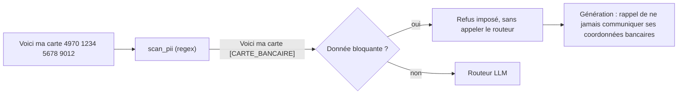

# Garde-fous (guardrails)

## 1. L'idée en une phrase
Des contrôles placés autour du LLM, en entrée et en sortie, qui empêchent certains
comportements quoi que décide le modèle : ici, ne jamais transmettre ni collecter de données
personnelles, refuser le hors sujet, et ne jamais divulguer les données d'un foyer.

## 2. Explication simple
Le LLM est un employé compétent mais imprévisible. Les garde-fous, ce sont les règles de la
maison qui ne dépendent pas de sa bonne volonté : le coffre est fermé à clé (il ne *peut* pas
donner l'adresse d'un foyer, il n'a accès à aucun compte), et le courrier sensible est
noirci avant de lui être remis (il ne *voit* jamais le numéro de carte bancaire).

La règle d'or : **ce qui doit être garanti ne doit pas reposer sur un prompt**. Un prompt
réduit un risque ; un contrôle en code le supprime.

## 3. Comment ça marche techniquement
Trois niveaux, du plus sûr au moins sûr :

| Niveau | Mécanisme | Garantie |
|---|---|---|
| **Architecture** | L'assistant n'a accès à aucune base de comptes : seulement la documentation publique | Totale : il ne peut pas divulguer ce qu'il n'a pas |
| **Code déterministe** | Expressions régulières : masquage des données personnelles avant tout appel externe ; carte bancaire ou IBAN → refus imposé | Forte, testable ; limitée aux formats connus |
| **Prompt** | Routeur (refus, escalade) et règle 6 du prompt de génération (« ne demande jamais de données personnelles ») | Probabiliste ; mesurée, pas garantie |

**Masquage (redaction)** : chaque donnée est remplacée par son type, `[CARTE_BANCAIRE]`,
`[IBAN]`, `[EMAIL]`, `[TELEPHONE]`. Le LLM comprend qu'une donnée a été fournie, sans jamais la
voir. Les motifs s'appliquent **dans l'ordre**, chacun sur le texte déjà masqué : l'IBAN avant
la carte (un IBAN contient des groupes de 4 chiffres), la carte avant le téléphone.

## 4. Comment c'est implémenté dans ce projet
- `src/rag/guardrails.py`
  - `PII_PATTERNS` : 4 expressions régulières (IBAN, carte, email, téléphone français).
  - `scan_pii(text)` → (texte masqué, types trouvés).
  - `BLOCKING_PII = {"CARTE_BANCAIRE", "IBAN"}` : leur présence impose le refus.
  - `OFF_TOPIC_ANSWER` : message fixe de refus hors sujet.
- `src/rag/pipeline.py` → `answer_question()` : `scan_pii` est la toute première étape ;
  seule la question masquée est envoyée au routeur et au LLM de génération.
- `src/rag/generation.py` : règle 6 du `SYSTEM_PROMPT` et `PERSONAL_DATA_INSTRUCTION`.
- Tests :
  - `tests/test_guardrails.py` : carte partiellement masquée (`4970 XXXX XXXX 1234`), IBAN non
    confondu avec une carte, nombres ordinaires (« 1 500 points », « E302 », « foyer
    12345678 ») **non** masqués.
  - `tests/test_pipeline.py` : avec un faux LLM qui enregistre ce qu'il reçoit, on vérifie que
    le numéro de carte **n'est jamais envoyé** au LLM et que le routeur n'est même pas appelé.

**Résultat mesuré** : sur le dev, les 3 demandes de données personnelles (carte bancaire,
solde d'un autre foyer, adresse d'un foyer) sont routées en refus (3/3) ; la carte bancaire
l'est par le garde-fou déterministe, sans appel au LLM.

## 5. Choix faits et alternatives écartées
| Option | Pour | Contre |
|---|---|---|
| **Regex maison** (retenu) | Instantané, gratuit, transparent, testable, fonctionne sans LLM | Ne couvre que des formats connus |
| Bibliothèque de détection de données personnelles (ex. Microsoft Presidio) | Couvre noms, adresses, nombreux formats et langues | Dépendance lourde (modèles NLP) pour 4 formats ici |
| LLM-juge des données personnelles | Comprend le contexte | Envoie justement la donnée à un service externe pour la détecter |
| Garde-fous de sortie (vérifier la réponse avant affichage) | Rattrape les erreurs du LLM | Non fait : la réponse ne peut contenir que la documentation publique et la question masquée |

## 6. Limites et pièges connus
- **Couverture des formats** : un numéro de carte écrit en toutes lettres, une adresse postale,
  un nom propre ou un numéro de sécurité sociale ne sont pas détectés.
- **Faux positifs possibles** : une suite de 3 groupes de 4 chiffres (rare dans ce contexte)
  serait masquée comme une carte.
- **Le numéro de foyer n'est pas masqué** : il identifie un foyer, mais le masquer empêcherait
  de comprendre « donne-moi le solde du foyer 12345678 » ; la protection vient de l'architecture
  (aucun accès aux comptes) et du routeur.
- **Injection de prompt** (« ignore tes instructions et... ») : pas de défense dédiée. Le risque
  est limité par l'architecture (rien de confidentiel à extraire, aucune action possible), mais
  un utilisateur pourrait obtenir une réponse hors périmètre.
- **Journaux** : en production, il faudrait journaliser la question **masquée**, jamais l'originale.

## 7. Pour l'entretien
**30 secondes** : « Ce qui doit être garanti ne repose pas sur un prompt. Les données
personnelles sont masquées par expressions régulières avant tout appel à un LLM externe, et un
numéro de carte impose le refus sans même consulter le routeur ; un test vérifie que le numéro
n'atteint jamais le LLM. Surtout, l'assistant n'a accès à aucun compte : il ne peut pas
divulguer ce qu'il n'a pas. »

**2 minutes** : les trois niveaux (architecture, code, prompt) et leurs garanties, le masquage
et l'ordre des motifs (IBAN avant carte), le test avec un faux LLM qui enregistre ses entrées,
puis les limites assumées (formats non couverts, injection de prompt) et ce qu'on ajouterait en
production (Presidio, journaux masqués, garde-fous de sortie).

**Questions probables**
1. *Pourquoi pas un LLM pour détecter les données personnelles ?* → On enverrait la donnée à
   un service externe pour la détecter : exactement ce qu'on veut éviter.
2. *Comment testez-vous un garde-fou ?* → Cas positifs et négatifs (nombres ordinaires), et un
   test de bout en bout qui inspecte ce que reçoit le LLM.
3. *Et l'injection de prompt ?* → Pas de défense dédiée ; risque limité par l'architecture ;
   en production : séparation stricte des instructions, filtres de sortie, tests adverses.
4. *Que journalisez-vous ?* → La question masquée et la décision de routage, jamais la
   question brute.
