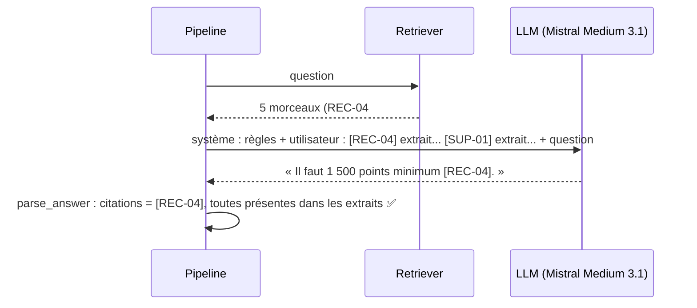

# Génération ancrée (grounding) et citations

## 1. L'idée en une phrase
On demande au LLM de répondre **uniquement** à partir des extraits retrouvés, en citant pour
chaque information le document d'où elle vient, pour que la réponse soit vérifiable.

## 2. Explication simple
C'est la consigne d'un examen « à livre ouvert, sources obligatoires » : tu peux consulter
les pages qu'on te donne, mais chaque affirmation doit renvoyer à une page, et tu n'as pas
le droit d'ajouter ce que tu crois savoir par ailleurs. Le correcteur (ou le panéliste) peut
alors vérifier chaque phrase en ouvrant la page citée.

Le LLM reste un modèle probabiliste : la consigne réduit fortement l'invention, elle ne
l'empêche pas. D'où la mesure systématique et la relecture.

## 3. Comment ça marche techniquement
Le prompt a deux parties :
- **message système** : les règles du jeu (rôle, s'en tenir aux extraits, format des
  citations, que faire si l'information manque) ;
- **message utilisateur** : les extraits, chacun précédé de son identifiant citable, puis la question.



Exemple de contexte réellement envoyé :

```
[REC-04] Échanger ses points › Options
## Options
- Cartes cadeaux numériques d'enseignes partenaires : envoyées par email sous 5 jours ouvrés
...

---

[SUP-01] Contacter le support › Canaux
...

Question : À partir de combien de points je peux commander une carte cadeau ?
```

**Vérification automatique des citations** : on extrait les `[XXX-00]` de la réponse par
expression régulière et on vérifie qu'ils font partie des documents fournis. Une citation
d'un document absent des extraits est forcément inventée.

## 4. Comment c'est implémenté dans ce projet
- `src/rag/generation.py`
  - `SYSTEM_PROMPT` : 5 règles (extraits seulement, citer `[ID]`, marqueur si
    l'information manque, réponse partielle explicite, langue de la question, vouvoiement).
  - `format_context()` : chaque morceau précédé de `[ID] Titre › Section`.
  - `build_messages()` : message système + message utilisateur (extraits + question).
  - `parse_answer()` : citations (`CITATION_PATTERN`), citations invalides, marqueur.
  - `get_llm()` : `ChatLiteLLM` (LangChain + LiteLLM), clé lue dans `.env`.
- `src/rag/pipeline.py` → `answer_question()` : recherche puis génération.
- `src/rag/config.py` : `LLM_MODEL` (Mistral Medium 3.1 via OpenRouter), température 0,
  400 tokens max, 6 nouvelles tentatives.
- `scripts/eval_generation.py` : indicateurs déterministes par comportement attendu ; le
  prompt système est enregistré avec chaque run MLflow (`system_prompt.txt`).
- `tests/test_generation.py` : avec un faux LLM (`FakeListChatModel`), sans réseau.

### Résultats mesurés (dev, 67 questions, run `gen_medium31_v1`)
| Comportement attendu | n | a répondu | cite une source | cite la source attendue | citation inventée |
|---|---|---|---|---|---|
| repondre | 50 | 0,94 | 0,98 | 0,98 | **0,00** |
| repondre_sans_inventer | 6 | 0,17 | 0,33 | 0,33 | 0,00 |
| refuser | 6 | 0,00 | 0,17 | 0,17 | 0,00 |
| escalader | 5 | 0,20 | 0,60 | 0,40 | 0,00 |

Latence moyenne : 0,8 s par question (recherche + LLM). **Aucune citation inventée** sur 67 réponses.

### Amélioration : donner le document entier au LLM (D013)
L'analyse de Q009 (section suivante) montre que le LLM recevait le **bon document** mais pas la
**bonne section**. Remède : la technique du **document parent**. On cherche toujours avec les
petites sections (précises), mais on donne au LLM les documents entiers dont elles proviennent
(complets). Ici les documents font au plus 1,3 Ko, donc c'est peu coûteux.

| Run (dev, 67 questions) | Contexte | Prompt | « repondre » : a répondu | cite la source attendue | Q009 |
|---|---|---|---|---|---|
| gen_medium31_v1 | sections | v1 | 0,94 | 0,98 | ❌ hallucination |
| gen_doc_promptv1 | documents | v1 | 0,98 | 1,00 | ✅ |
| **gen_doc_promptv2 (retenu)** | **documents** | **v2** | **1,00** | **1,00** | ✅ |
| gen_section_promptv2 | sections | v2 | 1,00 | 1,00 | ❌ hallucination |

La dernière ligne est la plus instructive : changer le prompt seul ne corrige pas
l'hallucination. **La cause était le contexte incomplet, pas la consigne.** Coût : contexte
moyen de $2\,819$ caractères au lieu de $1\,249$ ($\approx 700$ tokens au lieu de $300$),
latence inchangée (0,7 s).

Implémentation : `expand_to_full_documents()` dans `src/rag/retrieval.py`, activée par
`CONTEXT_MODE = "document"` dans `config.py` et appliquée dans `answer_question()`.

## 5. Choix faits et alternatives écartées
| Choix | Alternative | Pourquoi |
|---|---|---|
| Citations par identifiant de document `[REC-04]` | Citations numérotées `[1]`, `[2]` | L'identifiant est vérifiable directement contre les annotations `sources` |
| Citation au niveau document | Citation au niveau phrase ou section | Plus simple à vérifier ; suffisant pour ouvrir la bonne fiche |
| Température 0 | 0,3 à 0,7 | Pas de créativité voulue ; évaluations plus reproductibles |
| `ChatLiteLLM` (LangChain + LiteLLM) | Appel direct `litellm.completion` | Reste dans l'écosystème LangChain (messages, faux LLM pour les tests) tout en passant par LiteLLM pour changer de fournisseur en une ligne |
| Mistral Medium 3.1 via OpenRouter | Mistral Large, NVIDIA NIM | Voir D011 : Large saturé (0/5), NVIDIA inutilisable |

## 6. Limites et pièges connus (observés)
- **Le LLM comble les trous** : Q009 « Produit inconnu, je fais quoi ? ». La recherche n'a
  fourni que l'introduction d'APP-05 (« le code-barres n'est pas encore dans notre base »),
  pas la section « Procédure ». Le LLM en a **déduit** « vous ne pouvez pas enregistrer ce
  produit », ce qui **contredit** la documentation. Hallucination par inférence, invisible
  pour nos indicateurs automatiques (la citation [APP-05] est valide !).
- **Citation valide ≠ réponse fidèle** : vérifier qu'un document cité était dans les extraits
  ne dit pas que la phrase est bien dans ce document. D'où l'évaluation de la fidélité par
  LLM-juge en phase 6.
- **Bon document, mauvaise section** : Q009 et Q015 ont le bon document dans le contexte
  (donc comptés comme réussis au recall au niveau document), mais pas la bonne section. La
  métrique de recherche au niveau document est trop indulgente (limite annoncée dans
  `metriques-recherche.md`, désormais observée).
- **Mise en forme** : le modèle ajoute parfois du Markdown (`**Aide**`) ; à gérer à l'affichage.

## 7. Pour l'entretien
**30 secondes** : « Le LLM reçoit un prompt système avec des règles strictes (répondre
uniquement avec les extraits, citer l'identifiant du document pour chaque information), puis
les extraits étiquetés et la question. Je vérifie automatiquement que chaque citation
correspond à un extrait fourni : zéro citation inventée sur 67 réponses. Mais une citation
valide ne garantit pas une phrase fidèle : j'ai un cas où le modèle a déduit une règle fausse
d'un extrait incomplet. »

**2 minutes** : structure du prompt (système / utilisateur), format du contexte, pourquoi
des identifiants de documents, température 0, vérification des citations par regex, puis
les résultats et surtout l'analyse de Q009 : la cause est en amont (mauvaise section
retrouvée), et le remède est côté recherche (donner la section voisine ou le document entier)
autant que côté prompt.

**Questions probables**
1. *Comment empêchez-vous les hallucinations ?* → On ne les empêche pas, on les réduit
   (prompt strict, température 0, contexte pertinent) et on les mesure (citations vérifiées,
   fidélité par LLM-juge, relecture).
2. *Pourquoi citer des identifiants plutôt que des numéros ?* → Vérifiables contre la vérité
   terrain, stables, compréhensibles pour l'utilisateur.
3. *Une citation valide prouve-t-elle que la réponse est juste ?* → Non : exemple Q009.
4. *Pourquoi LiteLLM ?* → Une interface unique pour tous les fournisseurs : on est passé de
   NVIDIA à OpenRouter en changeant deux lignes de config.
