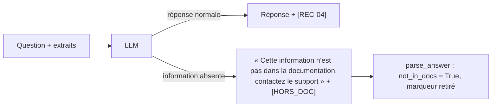

# Gestion du « je ne sais pas »

## 1. L'idée en une phrase
Quand la documentation ne contient pas la réponse, l'assistant doit le dire et orienter vers
le support, plutôt que de produire une réponse plausible mais inventée.

## 2. Explication simple
Un bon conseiller clientèle préfère « je ne trouve pas cette information, je vous passe un
collègue » à une réponse approximative. Un LLM, lui, est entraîné à toujours produire une
suite de texte plausible : sans consigne, il répond à « Les points sont-ils doublés à
Noël ? » par une promotion imaginaire. Il faut donc (1) lui donner le droit explicite de ne
pas savoir, et (2) pouvoir **détecter** qu'il a utilisé ce droit, pour l'afficher et le mesurer.

## 3. Comment ça marche techniquement
Trois familles d'approches, combinables :

| Approche | Principe | Limite |
|---|---|---|
| **Consigne dans le prompt** (retenue) | « Si les extraits ne contiennent pas l'information, dis-le » | Dépend du bon vouloir du modèle |
| Seuil sur le score de recherche | Si aucun morceau n'est assez proche, ne pas appeler le LLM | Les scores vectoriels sont mal calibrés (écarts de 0,03 entre bon et mauvais morceau, voir `rag.md`) |
| Vérification a posteriori | Un second appel juge si la réponse est soutenue par les extraits | Coût et latence doublés |

**Détection** : le LLM termine sa réponse par un marqueur `[HORS_DOC]`, que le code détecte
puis retire avant affichage. On utilise un marqueur plutôt qu'une phrase fixe (« Je ne trouve
pas... ») parce que le LLM répond dans la langue de la question : une phrase française ne
serait pas reconnue dans une réponse en anglais.

## 4. Comment c'est implémenté dans ce projet
- `src/rag/generation.py`
  - `NOT_IN_DOCS_MARKER = "[HORS_DOC]"` et règles 3 et 4 du `SYSTEM_PROMPT` (absent → marqueur ;
    partiel → répondre à la partie couverte et dire ce qui manque).
  - `parse_answer()` → `Answer.not_in_docs` et texte nettoyé.
- `scripts/eval_generation.py` : indicateur `answered` (pas de marqueur), ventilé par
  comportement attendu.

### Résultats mesurés (dev, run `gen_medium31_v1`)
| Comportement attendu | n | marqueur « hors doc » | Lecture après relecture humaine |
|---|---|---|---|
| repondre | 50 | 3 (6 %) | Q015 : bonne décision, la bonne section n'était pas dans les extraits ; Q009 : réponse partiellement fausse (voir `generation-ancree.md`) ; Q085 : bonne réponse, marqueur ajouté à tort pour une précision secondaire |
| repondre_sans_inventer | 6 | 5 | **6/6 comportements corrects** à la relecture : 5 aveux d'absence, et Q057 répond correctement (« le numéro est affiché dans la rubrique Aide ») sans inventer de numéro |

## 5. Choix faits et alternatives écartées
- **Consigne + marqueur** plutôt que seuil de score : les scores de similarité de notre modèle
  sont trop serrés pour séparer « pertinent » et « non pertinent » par un seuil. Un seuil sur
  un score de reranker (cross-encodeur) serait plus fiable : piste notée.
- **Pas de second appel de vérification** pour l'instant : double le coût et la latence ; la
  fidélité sera mesurée hors ligne en phase 6.

## 6. Limites et pièges connus (observés)
- **Le marqueur mélangeait « rien » et « partiel »** (prompt v1) : sur Q058, Q073, Q075 et Q085,
  le modèle répondait en partie **et** ajoutait le marqueur. **Corrigé par le prompt v2**
  (D013) : « marqueur seulement si AUCUNE information utile ; jamais avec une réponse, même
  partielle ». Sur le dev, toutes les questions « repondre » reçoivent alors une réponse, et
  les 6 questions pièges restent correctes à la relecture (4 aveux d'absence, 2 réponses
  partielles honnêtes : Q057 « le numéro est dans la rubrique Aide », Q058 « le nombre de
  points est indiqué dans chaque invitation »).
- **Risque du prompt v2, vérifié** : en poussant à répondre, il pourrait faire inventer quand
  le contexte est incomplet. Avec le contexte en documents entiers, rien de tel observé ; en
  mode sections, Q015 donne une réponse partielle honnête, mais l'hallucination de Q009
  persiste (voir `generation-ancree.md`).
- **Indicateur trop simple pour « repondre_sans_inventer »** : ces questions n'attendent pas
  toujours un aveu d'absence. Q057 attend une réponse (« le numéro est dans l'appli »), sans
  invention. Mesurer « ne pas inventer » demande un juge (phase 6), pas un marqueur.
- **« Je ne sais pas » à tort** : si la recherche rate la bonne section (Q015), le LLM a
  raison de dire qu'il ne sait pas... avec ce qu'on lui a donné. La cause est dans la recherche.
- **Refus poli ≠ hors documentation** : sur les questions hors sujet (« recette de gratin »),
  le modèle répond « ce n'est pas dans la documentation, contactez le support », ce qui est
  inadapté (le support ne donne pas de recettes). À traiter par le routage en phase 5.

## 7. Pour l'entretien
**30 secondes** : « Le prompt autorise explicitement le modèle à dire qu'il ne sait pas, et
lui demande d'ajouter un marqueur que je détecte en code, indépendamment de la langue. Sur les
6 questions pièges du dev, la relecture donne 6 comportements corrects sur 6. Le point faible
est que le modèle met aussi le marqueur quand il répond partiellement. »

**2 minutes** : pourquoi un LLM invente (il complète toujours), les trois approches (prompt,
seuil, vérification), pourquoi le marqueur plutôt qu'une phrase, les résultats et leur
relecture, puis les deux limites observées (marqueur sur les réponses partielles, « je ne sais
pas » causé par la recherche) et leurs remèdes.

**Questions probables**
1. *Comment détectez-vous qu'il ne sait pas ?* → Marqueur demandé dans le prompt, détecté et
   retiré en code.
2. *Pourquoi pas un seuil sur le score de similarité ?* → Scores mal calibrés ici (écarts de
   quelques centièmes) ; un score de reranker serait plus exploitable.
3. *Et si le modèle ne met pas le marqueur alors qu'il invente ?* → C'est le cas le plus
   dangereux, invisible pour cet indicateur : mesuré par la fidélité (LLM-juge) en phase 6.
4. *Taux de faux « je ne sais pas » ?* → 3 sur 50 questions répondables, dont 1 vraie réponse
   marquée à tort et 1 causée par la recherche.
