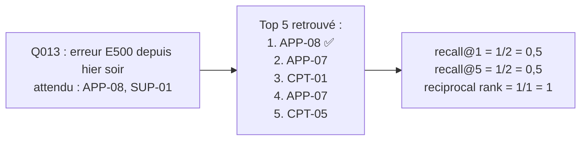

# Métriques de recherche : recall@k et MRR

## 1. L'idée en une phrase
Avant de juger les réponses du LLM, on vérifie que la recherche lui apporte les bons
documents : le **recall@k** dit *si* les bons documents sont dans les k premiers résultats,
le **MRR** dit *à quel rang* arrive le premier bon document.

## 2. Explication simple
Tu demandes à un bibliothécaire 5 livres sur ta question.
- **Recall@5** : parmi les livres qu'il fallait (disons 2), combien sont dans la pile de 5 ?
  1 sur 2 → 0,5.
- **MRR** : le premier bon livre est-il en haut de la pile (1), en 2e position (0,5), en 3e
  (0,33) ? On fait la moyenne sur toutes les questions.

Le recall dit « le LLM aura-t-il l'information sous les yeux ? ». Le MRR dit « la recherche
classe-t-elle bien ? ». Les deux comptent : un bon document en 5e position est présent, mais
noyé parmi 4 morceaux hors sujet que le LLM peut prendre à tort pour la réponse.

## 3. Comment ça marche techniquement
Pour une question $q$ dont les documents attendus forment l'ensemble $E_q$, et dont les
documents des $k$ premiers morceaux retrouvés forment l'ensemble $R_{q,k}$ :

$$
\text{recall@}k(q) = \frac{|R_{q,k} \cap E_q|}{|E_q|}
$$

$$
\text{RR}(q) = \frac{1}{\text{rang}_q} \quad \text{(rang du premier morceau appartenant à } E_q\text{ ; } \text{RR}(q) = 0 \text{ si aucun)}
$$

Sur un ensemble $\mathcal{Q}$ de questions, on fait la moyenne :

$$
\text{Recall@}k = \frac{1}{|\mathcal{Q}|} \sum_{q \in \mathcal{Q}} \text{recall@}k(q)
\qquad
\text{MRR} = \frac{1}{|\mathcal{Q}|} \sum_{q \in \mathcal{Q}} \text{RR}(q)
$$

Ce sont des métriques **de recherche**, sans LLM : rapides (quelques secondes pour 62
questions), gratuites, déterministes. On peut donc comparer beaucoup de variantes.

## 4. Comment c'est implémenté dans ce projet
- `src/rag/evaluation.py`
  - `recall_at_k()` et `reciprocal_rank()` : les formules ci-dessus, en 3 lignes chacune.
  - `evaluate_question()` : une ligne de résultat par question (attributs, documents
    retrouvés, métriques).
  - `average()` / `average_by()` : moyennes globales et ventilées par type ou par style.
  - `load_eval_questions(split)` : questions du split qui ont au moins une source.
- `scripts/eval_retrieval.py` : interroge le retriever (k = 5 une seule fois, le top 1 et le
  top 3 en sont les débuts), affiche les tableaux et la liste des échecs, et enregistre le
  run dans MLflow (paramètres, métriques globales et par groupe, détail par question en
  artefact `per_question.json`).
- `tests/test_evaluation.py` : formules vérifiées sur des cas calculés à la main.

**Conventions à connaître (et à annoncer en entretien)** :
- **Niveau document** : les annotations désignent des documents (REC-04), pas des sections.
  Un morceau est pertinent s'il appartient à un document attendu.
- **k compte des morceaux**, pas des documents distincts, car c'est ce que le LLM reçoit.
  Deux morceaux du même document occupent deux places.
- **Questions sans source exclues** (5 sur 67 en dev : hors sujet, informations absentes) :
  le recall n'y a pas de sens ; elles seront évaluées sur le comportement.
- **Uniquement sur le dev** (62 questions). Le test n'est pas touché (voir D002, D003).

### Résultats de la baseline (recherche vectorielle seule, dev, 62 questions)
| | n | recall@1 | recall@3 | recall@5 | MRR |
|---|---|---|---|---|---|
| **Global** | 62 | 0,723 | 0,852 | **0,922** | **0,862** |
| factuelle | 41 | 0,829 | 0,963 | 0,988 | 0,921 |
| multi_docs | 8 | 0,542 | 0,729 | 0,833 | 0,938 |
| piege_invention | 4 | 0,750 | 1,000 | 1,000 | 0,875 |
| securite_donnees | 4 | 0,500 | 0,500 | 0,875 | 0,613 |
| escalade | 5 | 0,300 | 0,300 | 0,500 | 0,450 |
| standard | 56 | 0,729 | 0,854 | 0,914 | 0,870 |
| anglais | 3 | 0,667 | 1,000 | 1,000 | 0,833 |
| fautes | 3 | 0,667 | 0,667 | 1,000 | 0,750 |

Lecture : sur les questions factuelles, la recherche vectorielle est presque parfaite au
top 5 (0,988). Les faiblesses sont concentrées sur l'**escalade**, la **sécurité** et les
**questions multi-documents**. Les groupes de 3 à 5 questions ne permettent aucune
conclusion ferme (une question = 20 à 33 points).

## 5. Choix faits et alternatives écartées
| Métrique | Pourquoi / pourquoi pas |
|---|---|
| **Recall@k** (retenu) | Répond à la question qui compte pour le RAG : le LLM aura-t-il l'information ? |
| **MRR** (retenu) | Mesure le classement ; simple à expliquer |
| Hit rate@k (au moins un document attendu trouvé) | Plus indulgent sur les questions multi-sources ; le recall est plus exigeant et plus informatif |
| Precision@k | Peu utile ici : le nombre de documents pertinents (1 à 3) est inférieur à k, la précision est plafonnée mécaniquement |
| nDCG | Utile avec des niveaux de pertinence gradués (très pertinent / un peu) ; nos annotations sont binaires |
| Métriques au niveau section | Plus fines, mais demanderaient d'annoter les sections attendues |

## 6. Limites et pièges connus
- **Les métriques dépendent des annotations** : si `sources` oublie un document qui répond
  aussi, une bonne recherche est comptée fausse. À l'inverse, Q074 (« parler à un humain »)
  attend SUP-01 alors que la question ne contient aucun mot du document : c'est un cas de
  **routage** plus que de recherche.
- **Niveau document = indulgent** : retrouver la mauvaise section du bon document compte
  comme un succès, alors que le LLM n'aura peut-être pas la bonne information.
- **Petits effectifs** : 62 questions, et 3 à 8 par sous-groupe. Un écart de quelques points
  entre deux variantes peut être du bruit.
- **Recall élevé ≠ bonne réponse** : c'est une condition nécessaire, pas suffisante ; la
  génération est évaluée à part (phase 4).
- **Sur-optimiser le dev** : à force de régler sur les mêmes 62 questions, on finit par
  sur-apprendre ; c'est pour ça que le test reste intact.

## 7. Pour l'entretien
**30 secondes** : « J'évalue la recherche séparément de la génération, avec le recall@k (les
bons documents sont-ils dans le top k ?) et le MRR (à quel rang arrive le premier ?), sur les
sources annotées du jeu de dev. Ma baseline vectorielle atteint 0,92 de recall@5 et 0,86 de
MRR ; elle est quasi parfaite sur les questions factuelles et faible sur l'escalade. »

**2 minutes** : pourquoi évaluer la recherche seule (rapide, gratuit, déterministe, isole la
cause d'une mauvaise réponse), définitions et conventions (niveau document, k en morceaux,
questions sans source exclues), résultats ventilés, puis l'analyse d'erreurs : les échecs
viennent surtout de documents « secondaires » (support, réclamations) que la question ne
mentionne pas, et d'un cas de correspondance exacte raté (« carte bancaire »), qui motive la
recherche hybride.

**Questions probables**
1. *Pourquoi le recall plutôt que la précision ?* → Le LLM peut ignorer un morceau inutile,
   pas inventer un morceau manquant ; et la précision est plafonnée quand il y a moins de
   documents pertinents que k.
2. *Comment avez-vous obtenu la vérité terrain ?* → Jeu annoté (sources attendues par
   question) ; limites : annotation au niveau document, biais de l'annotateur.
3. *Vos chiffres sont-ils significatifs ?* → 62 questions : les écarts de moins de ~5 points
   au global, ou sur des sous-groupes de 3 à 8 questions, ne sont pas concluants.
4. *Et en production, sans annotations ?* → Échantillonner des conversations et les annoter,
   suivre des signaux indirects (clics sur les sources, escalades, « pouce vers le bas »),
   ou utiliser un LLM pour juger la pertinence (avec ses propres biais).
