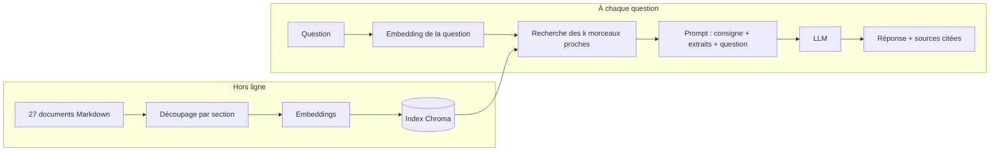

# RAG (Retrieval-Augmented Generation)

## 1. L'idée en une phrase
Avant de répondre, le modèle de langage va chercher les passages pertinents dans une base
documentaire, et il répond **à partir de ces passages** plutôt que de sa mémoire.

## 2. Explication simple
Un LLM seul, c'est un candidat qui passe un examen **sans documents** : il répond avec ce
qu'il a appris pendant son entraînement, qui est daté, général, et qui ne contient
évidemment pas la FAQ interne de PanelConso. Quand il ne sait pas, il a tendance à
inventer une réponse plausible (hallucination).

Le RAG, c'est le même candidat en examen **avec documents autorisés** : on lui donne les
3 à 5 pages utiles du classeur, il répond en s'appuyant dessus, et il peut dire « page 12 »
(citation). S'il n'y a rien dans le classeur, il peut dire « ce n'est pas dans mes documents ».

## 3. Comment ça marche techniquement
Deux temps bien séparés :

- **Hors ligne (ingestion)** : on découpe les documents en morceaux (*chunks*), on
  transforme chaque morceau en vecteur (*embedding*), on range les vecteurs dans un index.
- **En ligne (à chaque question)** : on transforme la question en vecteur, on récupère
  les k morceaux les plus proches (*retrieval*), on les insère dans le prompt avec une
  consigne du type « réponds uniquement à partir de ces extraits », et le LLM génère.



## 4. Comment c'est implémenté dans ce projet
| Étape | Fichier | Phase | État |
|---|---|---|---|
| Paramètres | `src/rag/config.py` | toutes | ✅ |
| Lecture, découpage, index | `src/rag/ingestion.py` (`load_corpus`, `split_into_chunks`, `build_index`) | 1 | ✅ |
| Embeddings | `src/rag/embeddings.py` (`get_embeddings`) | 1 | ✅ |
| Recherche vectorielle | `src/rag/retrieval.py` (`load_vector_store`, `get_vector_retriever`) | 2 | ✅ |
| Évaluation de la recherche | `src/rag/evaluation.py`, `scripts/eval_retrieval.py` | 2 | ✅ |
| BM25 et recherche hybride | `src/rag/retrieval.py` (`get_bm25_retriever`, `get_hybrid_retriever`, `get_retriever`) | 3 | ✅ testée, non retenue (D009) |
| Génération ancrée | `src/rag/generation.py`, `src/rag/pipeline.py`, `scripts/eval_generation.py` | 4 | ✅ (voir `generation-ancree.md`) |
| Garde-fous (données personnelles) | `src/rag/guardrails.py` | 5 | ✅ (voir `garde-fous.md`) |
| Routage par intention, escalade, refus | `src/rag/router.py`, `src/rag/pipeline.py`, `scripts/eval_routing.py` | 5 | ✅ (voir `routage-intention.md`) |
| LLM-juge et évaluation de bout en bout | `src/rag/judge.py`, `scripts/eval_e2e.py`, `scripts/validate_judge.py` | 6 | ✅ (voir `evaluation-generation.md`) |
| CI d'évaluation | `.github/workflows/`, `CI_THRESHOLDS` dans `config.py` | 6 | ✅ (voir `ci-evaluation.md`) |
| API, interface de chat, image Docker | `src/rag/api.py`, `app/`, `Dockerfile`, `docker-compose.yml` | 7 | ✅ (voir `service-api-docker.md`) |

Cette section parcourt le code **déjà écrit** (la partie « hors ligne » du schéma, plus un
premier essai de recherche). Elle sera complétée à chaque phase.

### 4.1 Le fil conducteur : `main()` dans `ingestion.py`
C'est le point d'entrée, lancé par `uv run python -m rag.ingestion`. Il se lit comme le
schéma « Hors ligne » ci-dessus, une ligne par étape :

```python
def main() -> None:
    start = time.perf_counter()
    documents = load_corpus()                     # 1. lire les 27 fichiers
    chunks = split_into_chunks(documents)         # 2. les découper en 80 morceaux
    build_index(chunks, get_embeddings())         # 3. vectoriser et ranger dans Chroma
    ...                                           # 4. afficher quelques statistiques
```

Chaque étape est une fonction séparée, testable seule : c'est ce qui permet, en phase 2,
de changer le découpage sans toucher au reste et de mesurer l'effet.

### 4.2 Étape 1 : lire un document et ses métadonnées
Chaque fichier du corpus commence par un **frontmatter**, un petit bloc de métadonnées :

```markdown
---
id: REC-04
titre: Échanger ses points
categorie: recompenses
version: 3.2
date_maj: 2026-03-01
---
# Échanger ses points

Un minimum de 1 500 points est nécessaire pour tout échange. ...
```

```python
def parse_markdown_file(path: Path) -> tuple[dict[str, str], str]:
    text = path.read_text(encoding="utf-8")
    if not text.startswith("---\n"):
        raise ValueError(f"{path.name} : frontmatter manquant")
    _, frontmatter, body = text.split("---\n", 2)
    metadata = {}
    for line in frontmatter.splitlines():
        key, _, value = line.partition(":")
        metadata[key.strip()] = value.strip()
    return metadata, body
```

- `text.split("---\n", 2)` coupe le texte sur les deux premières lignes `---` : on obtient
  `["", <bloc de métadonnées>, <corps Markdown>]`. Le `2` limite à deux coupures, pour ne pas
  casser le corps s'il contenait lui-même un `---`.
- `line.partition(":")` coupe sur le **premier** `:` seulement. C'est voulu : un titre comme
  « Un titre : avec deux-points » garde tout ce qui suit le premier `:` (un test le vérifie).
- Pourquoi ne pas utiliser une bibliothèque de frontmatter ? Le format est trivial (des
  lignes `clé: valeur`), dix lignes suffisent et évitent une dépendance.

```python
def load_corpus(corpus_dir: Path = config.CORPUS_DIR) -> list[Document]:
    documents = []
    for path in sorted(corpus_dir.rglob("*.md")):
        metadata, body = parse_markdown_file(path)
        metadata["source"] = path.relative_to(corpus_dir).as_posix()
        documents.append(Document(page_content=body, metadata=metadata))
    return documents
```

- `rglob("*.md")` parcourt tous les sous-dossiers (`compte/`, `technique/`...).
- `sorted(...)` rend l'ordre **déterministe** : même ordre sur Windows, Linux et en CI, donc
  mêmes identifiants de morceaux d'une exécution à l'autre.
- `Document` est la structure de base de LangChain : un texte (`page_content`) + un
  dictionnaire de métadonnées. Tous les composants LangChain (découpeurs, vector stores,
  retrievers) échangent des `Document`, c'est ce qui les rend combinables.
- `source` (ex. `recompenses/REC-04_echanger-points.md`) est ajouté pour pouvoir retrouver
  le fichier d'origine.

### 4.3 Étape 2 : découper en morceaux qui gardent leur « étiquette »
```python
def split_into_chunks(documents: list[Document]) -> list[Document]:
    header_splitter = MarkdownHeaderTextSplitter(config.HEADERS_TO_SPLIT_ON, strip_headers=False)
    size_splitter = RecursiveCharacterTextSplitter(
        chunk_size=config.CHUNK_SIZE, chunk_overlap=config.CHUNK_OVERLAP
    )
    chunks = []
    for document in documents:
        sections = size_splitter.split_documents(header_splitter.split_text(document.page_content))
        for position, section in enumerate(sections):
            section.metadata = {
                **document.metadata,
                **section.metadata,
                "chunk_id": f"{document.metadata['id']}#{position}",
            }
            chunks.append(section)
    return chunks
```

Lecture pas à pas :

1. `header_splitter.split_text(...)` coupe le corps Markdown à chaque titre `#` ou `##`
   (`HEADERS_TO_SPLIT_ON` dans la config). Il renvoie une liste de `Document`, un par section,
   avec en métadonnées les titres rencontrés : `titre_doc` (le `#`) et `section` (le `##`).
2. `strip_headers=False` laisse la ligne `## Compte bloqué` **dans le texte** du morceau.
   Sans ça, le titre ne serait qu'en métadonnée, et le modèle d'embeddings ne le verrait
   pas ; or c'est souvent le mot le plus proche de la question posée.
3. `size_splitter.split_documents(...)` ne recoupe que les sections de plus de 1 000
   caractères. Sur le corpus actuel, il ne fait rien (la plus longue fait 750) : c'est un
   filet de sécurité pour les futurs documents.
4. La fusion `{**document.metadata, **section.metadata, "chunk_id": ...}` est la ligne
   clé : chaque morceau **hérite** des métadonnées de son document (`id`, `categorie`,
   `version`...), plus sa section et un identifiant unique. C'est ce qui permettra plus
   tard de **citer** la source (« d'après REC-04 ») et de **filtrer** par catégorie.
5. `chunk_id = "CPT-01#2"` : identifiant **stable** (même document, même position → même
   id), utile pour déboguer et pour comparer deux versions de l'index.

Exemple réel de métadonnées d'un morceau (`CPT-02#1`) :

```python
{'id': 'CPT-02', 'titre': 'Composition du foyer et questionnaire annuel',
 'categorie': 'compte', 'version': '1.7', 'date_maj': '2025-11-03',
 'source': 'compte/CPT-02_foyer-questionnaire-annuel.md',
 'titre_doc': 'Composition du foyer et questionnaire annuel',
 'section': 'Questionnaire de profil annuel', 'chunk_id': 'CPT-02#1'}
```

### 4.4 Étape 3a : le modèle d'embeddings
```python
def get_embeddings() -> HuggingFaceEmbeddings:
    return HuggingFaceEmbeddings(
        model_name=config.EMBEDDING_MODEL,
        encode_kwargs={"prompt": config.PASSAGE_PREFIX, "normalize_embeddings": True},
        query_encode_kwargs={"prompt": config.QUERY_PREFIX, "normalize_embeddings": True},
    )
```

- `HuggingFaceEmbeddings` télécharge le modèle une fois (~470 Mo, mis en cache) et le fait
  tourner **en local** sur le CPU : aucune donnée ne sort de la machine, aucun coût d'API.
- LangChain distingue deux méthodes : `embed_documents(...)` pour les passages indexés, et
  `embed_query(...)` pour la question. `encode_kwargs` s'applique à la première,
  `query_encode_kwargs` à la seconde. C'est ce qui permet d'ajouter `passage: ` d'un côté et
  `query: ` de l'autre, comme le modèle E5 l'exige (voir la fiche embeddings).
- `normalize_embeddings=True` donne des vecteurs de longueur 1 : on peut alors comparer
  indifféremment par cosinus ou par distance L2, le classement est le même.

### 4.5 Étape 3b : ranger les vecteurs dans Chroma
```python
def build_index(chunks: list[Document], embeddings: Embeddings) -> Chroma:
    shutil.rmtree(config.CHROMA_DIR, ignore_errors=True)
    return Chroma.from_documents(
        chunks,
        embeddings,
        ids=[chunk.metadata["chunk_id"] for chunk in chunks],
        collection_name=config.COLLECTION_NAME,
        persist_directory=str(config.CHROMA_DIR),
    )
```

- `shutil.rmtree(...)` efface l'ancien index avant de reconstruire. Choix délibéré : mettre à
  jour un index est plus complexe (quels morceaux ont changé ? lesquels ont disparu ?), et le
  reconstruire prend moins de 20 secondes. Aucun risque de garder un morceau périmé.
- `Chroma.from_documents(...)` fait trois choses en une ligne : appelle
  `embeddings.embed_documents(...)` sur les 80 textes, stocke chaque vecteur avec son texte
  et ses métadonnées, et écrit le tout sur disque dans `data/chroma/`.
- Le type du paramètre est `Embeddings` (l'interface LangChain), pas
  `HuggingFaceEmbeddings` : dans les tests, on passe de **faux** embeddings
  (`DeterministicFakeEmbedding`) pour vérifier le stockage sans charger le vrai modèle.

### 4.6 Premier aperçu de la recherche (avant la phase 2)
Le module de recherche n'existe pas encore, mais l'index peut déjà être interrogé :

```python
store = Chroma(
    collection_name=config.COLLECTION_NAME,
    embedding_function=get_embeddings(),
    persist_directory=str(config.CHROMA_DIR),
)
store.similarity_search_with_score("J'ai oublié mon mot de passe", k=3)
```

Résultats réels (le score est une **distance** : plus il est petit, plus c'est proche) :

| Question | Rang 1 | Rang 2 | Rang 3 |
|---|---|---|---|
| J'ai oublié mon mot de passe | 0,271 `CPT-01#1` Mot de passe oublié ✅ | 0,286 `CPT-01#3` Changement d'adresse email | 0,299 `CPT-01#2` Compte bloqué |
| I forgot my password | 0,330 `CPT-01#2` Compte bloqué | 0,336 `CPT-01#1` Mot de passe oublié ✅ | 0,349 `APP-07#3` Économie de données ❌ |

Ce que ça montre :
- **Au niveau du document, ça marche** : les deux questions retrouvent CPT-01 en tête, y
  compris en anglais sur un corpus français.
- **Au niveau de la section, c'est fragile** : en anglais, la bonne section n'arrive qu'en 2e
  position, et un morceau sans rapport (APP-07) entre dans le top 3.
- **Les écarts de score sont minces** (0,271 contre 0,299) : le petit modèle distingue mal
  des sections proches du même document. D'où l'intérêt d'un k > 1 et de la recherche
  hybride (phase 3).
- Pour lire le score : Chroma renvoie ici une distance L2 **au carré**. Avec des vecteurs
  normalisés ($\|q\| = \|p\| = 1$) :

  $$
  \|q - p\|^2 = \|q\|^2 + \|p\|^2 - 2\, q \cdot p = 2 - 2 \cos(q, p)
  \quad\Longrightarrow\quad
  \cos(q, p) = 1 - \frac{d}{2}
  $$

  Une distance $d = 0{,}271$ correspond donc à un cosinus de $1 - 0{,}271/2 \approx 0{,}86$.

Deux exemples ne prouvent rien : c'est précisément ce que la phase 2 mesure sur le jeu de dev.

### 4.7 La recherche en code (phase 2)
```python
def load_vector_store(embeddings: Embeddings | None = None) -> Chroma:
    if not config.CHROMA_DIR.exists():
        raise FileNotFoundError(f"Index absent ({config.CHROMA_DIR}) : lancer `uv run python -m rag.ingestion`")
    return Chroma(
        collection_name=config.COLLECTION_NAME,
        embedding_function=embeddings or get_embeddings(),
        persist_directory=str(config.CHROMA_DIR),
    )


def get_vector_retriever(k: int = config.TOP_K, store: Chroma | None = None) -> VectorStoreRetriever:
    return (store or load_vector_store()).as_retriever(search_kwargs={"k": k})
```

- `load_vector_store` **rouvre** l'index écrit par l'ingestion : on ne recalcule pas les
  80 embeddings à chaque question, seul celui de la question est calculé. Le message
  d'erreur dit quoi faire si l'index n'existe pas (sinon Chroma créerait silencieusement une
  collection vide et toutes les recherches renverraient zéro résultat).
- `embedding_function` doit être **le même modèle** qu'à l'indexation, sinon la question et
  les morceaux seraient des vecteurs de deux « cartes » différentes.
- `as_retriever(...)` emballe le store dans un **retriever** : un objet LangChain avec une
  seule méthode, `.invoke(question) → list[Document]`. Tous les types de recherche (vectorielle,
  BM25, hybride) exposent cette même interface ; en phase 3, on changera de retriever sans
  toucher au code qui l'utilise.

Utilisation :

```python
retriever = get_vector_retriever(k=5)
chunks = retriever.invoke("Je veux parler à un humain")
[chunk.metadata["chunk_id"] for chunk in chunks]
# ['APP-07#1', 'APP-01#4', 'RGPD-02#2', 'CPT-05#0', 'APP-07#3']   ← résultat réel : SUP-01 absent
```

Mesuré sur les 62 questions du dev : **recall@5 = 0,922, MRR = 0,862** (détail et analyse
des erreurs dans la fiche `metriques-recherche.md`).

## 5. Choix faits et alternatives écartées
**Pourquoi RAG et pas du fine-tuning ?** Le fine-tuning (ré-entraîner le modèle sur nos
documents) est la solution qui vient souvent en premier à l'esprit. Elle est mal adaptée ici :

| Critère | RAG | Fine-tuning |
|---|---|---|
| Mise à jour d'un document (nouveau barème de points) | Ré-indexer, quelques secondes | Ré-entraîner |
| Citer la source | Naturel : on sait quels extraits ont été fournis | Impossible : la connaissance est diluée dans les poids |
| Dire « je ne sais pas » | Possible : si rien de pertinent n'est retrouvé | Difficile : le modèle ne sait pas ce qu'il ne sait pas |
| Coût | Aucun entraînement | GPU, jeu d'entraînement à construire |
| Données | 27 documents suffisent | Des milliers d'exemples question/réponse |

Le fine-tuning sert plutôt à changer le **comportement** du modèle (style, format, ton,
vocabulaire métier), pas à lui apprendre des **faits** qui changent. Les deux se combinent
parfois : RAG pour les faits, fine-tuning pour le style.

Autre alternative : **mettre tout le corpus dans le prompt** (27 documents ≈ 20 Ko, ça
tiendrait dans le contexte des LLM récents). C'est une vraie option à ce volume, mais elle
ne passe pas à l'échelle (coût par question proportionnel au corpus entier), et elle dilue
l'attention du modèle sur beaucoup de texte non pertinent.

## 6. Limites et pièges connus
- **La réponse ne peut pas être meilleure que la recherche** : si le bon passage n'est pas
  retrouvé, le LLM ne peut pas l'inventer (ou pire, il invente). D'où l'évaluation séparée
  de la recherche (phase 2) et de la génération (phase 4).
- Le LLM peut **ignorer les extraits** et répondre de mémoire : il faut un prompt strict et
  mesurer la fidélité.
- Les **questions multi-documents** (ex. vacances + bonus d'assiduité) demandent de
  retrouver plusieurs passages à la fois.
- Un corpus **contradictoire ou périmé** donne des réponses fausses mais bien sourcées.

## 7. Pour l'entretien
**30 secondes** : « Le RAG, c'est donner au LLM les bons extraits de documentation au
moment de répondre, au lieu de compter sur sa mémoire. On indexe les documents en
vecteurs, on retrouve les passages proches de la question, et le LLM répond uniquement à
partir d'eux, en citant ses sources. C'est à jour, traçable, et ça permet de dire "je ne
sais pas". »

**2 minutes** : reprendre les deux temps (ingestion hors ligne / recherche + génération en
ligne), donner l'exemple concret du projet (27 documents de support, sections indexées dans
Chroma avec un modèle E5 multilingue), expliquer pourquoi pas de fine-tuning (les faits
changent, il faut citer, pas assez de données), et finir sur l'évaluation : on mesure la
recherche (recall@k) séparément de la génération (fidélité), parce qu'une mauvaise réponse
peut venir de l'une ou de l'autre.

**Questions probables**
1. *Pourquoi pas du fine-tuning ?* → Tableau de la section 5 : faits qui changent,
   citations, « je ne sais pas », coût.
2. *Comment savez-vous que votre RAG marche ?* → Deux étages d'évaluation : recherche
   (recall@k, MRR sur les sources annotées) puis génération (fidélité, comportement attendu),
   sur un jeu de test tenu à part.
3. *Qu'est-ce qui casse le plus souvent ?* → La recherche : questions formulées
   différemment du document (familier, fautes, anglais), questions multi-documents.
4. *Avec un contexte de 1 M de tokens, le RAG est-il encore utile ?* → Oui dès que le
   corpus dépasse le contexte, pour le coût et la latence, et pour la traçabilité ; ici,
   27 documents tiendraient dans le prompt, c'est une baseline à considérer honnêtement.
