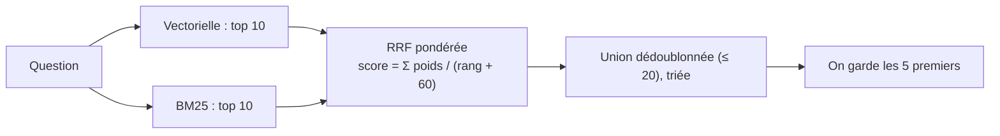

# Recherche hybride et fusion par RRF

## 1. L'idée en une phrase
On lance deux recherches complémentaires (vectorielle pour le sens, BM25 pour les mots
exacts) et on fusionne leurs **classements** en une seule liste, avec la Reciprocal Rank
Fusion (RRF).

## 2. Explication simple
Deux experts classent les mêmes candidats : l'un juge le fond (embeddings), l'autre vérifie
les mots-clés (BM25). Leurs notes ne sont pas sur la même échelle (une distance cosinus d'un
côté, un score BM25 sans borne de l'autre) : on ne peut pas les additionner. On additionne
donc des **points de classement** : être 1er chez un expert rapporte un peu plus qu'être 5e,
et être bien classé **chez les deux** rapporte le plus.

## 3. Comment ça marche techniquement
Pour chaque morceau $d$, sur chaque liste $i$ où il apparaît au rang $r_i(d)$, avec le
poids $w_i$ de cette liste :

$$
\text{score}_{\text{RRF}}(d) = \sum_{i} \frac{w_i}{r_i(d) + c} \qquad \text{avec } c = 60
$$

Une liste où $d$ n'apparaît pas n'ajoute rien à son score.

- On n'utilise que les **rangs**, jamais les scores bruts : c'est ce qui rend la fusion
  robuste à des échelles incomparables.
- La constante $c = 60$ (valeur de l'article d'origine, Cormack et al., 2009) **écrase les
  écarts entre rangs** : $\frac{1}{1+60} = \frac{1}{61}$ pour le 1er, $\frac{1}{65}$ pour le 5e.
  Conséquence directe : apparaître dans les deux listes, même moyennement classé, vaut
  presque le double d'une première place dans une seule liste.

**Exemple réel (Q068, poids 0,5 / 0,5)** :

| Morceau | Rang vectoriel | Rang BM25 | Score RRF |
|---|---|---|---|
| `APP-01#2` (Première connexion) | 7 | 3 | $\frac{0{,}5}{7+60} + \frac{0{,}5}{3+60} \approx$ **0,0154** |
| `RGPD-03#2` (Informations bancaires) ✅ | absent du top 10 | 2 | $\frac{0{,}5}{2+60} \approx$ **0,0081** |

Le bon morceau, que BM25 avait trouvé, est battu par un morceau médiocre présent dans les
deux listes : c'est le comportement « consensus » de la RRF, qui est ici un défaut.

## 4. Comment c'est implémenté dans ce projet
- `src/rag/retrieval.py` → `get_hybrid_retriever()` :
  - `EnsembleRetriever` (package `langchain-classic`) avec le retriever vectoriel et le
    retriever BM25, chacun renvoyant `FUSION_CANDIDATES = 10` morceaux ;
  - `weights=[VECTOR_WEIGHT, 1 - VECTOR_WEIGHT]`, `c=RRF_C` (60) ;
  - `id_key="chunk_id"` : deux morceaux sont « le même » s'ils ont le même identifiant
    (par défaut LangChain compare les textes) ;
  - `ensemble | RunnableLambda(lambda chunks: chunks[:k])` : **troncature à k**, car
    `EnsembleRetriever` renvoie l'union complète des deux listes (jusqu'à 20 morceaux). Sans
    elle, on comparerait un top 20 hybride à un top 5 vectoriel, et le LLM recevrait 4 fois
    plus de texte.
- `get_retriever(mode, k, vector_weight)` : point d'entrée unique, `mode` ∈ vector / bm25 / hybrid.
- `scripts/eval_retrieval.py --retrieval hybrid --vector-weight 0.7` : chaque run est tracé
  dans MLflow avec ses paramètres (`vector_weight`, `fusion_candidates`, `rrf_c`).
- `tests/test_retrieval.py` : troncature à k, unicité des morceaux, et avec un poids
  vectoriel nul, l'hybride reproduit exactement le classement BM25.

### Résultats mesurés (dev, 62 questions)
| Run | recall@1 | recall@3 | recall@5 | MRR |
|---|---|---|---|---|
| **vectorielle seule (baseline)** | **0,723** | 0,852 | **0,922** | **0,862** |
| BM25 seul | 0,575 | 0,758 | 0,796 | 0,728 |
| hybride, poids vectoriel 0,3 | 0,688 | 0,831 | 0,844 | 0,815 |
| hybride, poids vectoriel 0,5 | 0,720 | 0,836 | 0,892 | 0,851 |
| hybride, poids vectoriel 0,7 | 0,720 | 0,868 | 0,901 | 0,858 |
| BM25 français seul (mots vides + racinisation) | 0,608 | 0,863 | 0,884 | 0,789 |
| **hybride français, poids 0,5** | **0,777** | **0,884** | 0,898 | **0,890** |
| hybride français, poids 0,7 | 0,712 | 0,884 | 0,906 | 0,864 |

**Mise à jour après l'analyseur français (D010)** : une fois BM25 débarrassé de ses mots vides
et racinisé, l'hybride à poids égaux devient le **meilleur classement** (recall@1 +5,4 points,
MRR +2,8 points), mais reste un peu derrière la baseline au top 5 (0,898 contre 0,922).
Comparaison question par question : 5 questions mieux classées en tête, 1 moins bien ;
2 questions perdues au top 5, 1 gagnée. Écarts non significatifs sur 62 questions.

**Conclusion honnête : la recherche hybride n'améliore pas la baseline sur ce corpus.** Le
seul gain (recall@3, 0,868 contre 0,852) correspond à une seule question, ce qui n'est pas
significatif. Plus on donne de poids au vectoriel, meilleur est le résultat : BM25 apporte
ici plus de bruit que de signal.

## 5. Choix faits et alternatives écartées
| Option | Commentaire |
|---|---|
| **RRF** (retenu pour l'expérience) | Pas de normalisation de scores à calibrer ; standard (Elasticsearch, OpenSearch, Weaviate) |
| Combinaison linéaire de scores normalisés : $\alpha \cdot \cos + (1 - \alpha) \cdot \widetilde{\text{BM25}}$ | Garde l'information d'écart entre scores, mais la normalisation BM25 (min-max par requête) est fragile |
| Re-ranking par un cross-encoder | Souvent le meilleur gain de qualité ; ajoute un modèle et de la latence ; piste pour plus tard |
| Régler `c` | Écarté : avec 62 questions, régler deux paramètres de fusion reviendrait à sur-apprendre le dev |

**Décision** : `RETRIEVAL_MODE = "vector"` par défaut. Le code hybride est conservé et testé
pour les expériences suivantes (BM25 amélioré).

## 6. Limites et pièges connus
- **La fusion ne vaut que ce que vaut le plus faible des deux** si les poids sont proches :
  fusionner un bon classement et un classement bruité dégrade le premier.
- **La RRF à c = 60 favorise le consensus** : un morceau trouvé par un seul retriever, même
  en tête, perd face aux morceaux moyens des deux listes (exemple Q068 ci-dessus).
- **Le piège de la troncature** : `EnsembleRetriever` ne tronque pas ; oublier de le faire
  fausse toutes les comparaisons.
- **Petits effectifs** : 62 questions ; 1 question = 1,6 point de recall global.
- **Régler les poids sur le dev** : 3 valeurs testées seulement, pour limiter le sur-apprentissage.

## 7. Pour l'entretien
**30 secondes** : « J'ai testé une recherche hybride vectorielle + BM25 fusionnée par RRF.
Sur mon jeu de dev, elle ne bat pas la recherche vectorielle seule : 0,90 contre 0,92 de
recall@5 au mieux. L'analyse d'erreurs montre pourquoi : BM25 sans racinisation est bruité
en français, et la RRF favorise les documents moyens présents dans les deux listes. J'ai
gardé le vectoriel par défaut, et je sais quoi tester ensuite. »

**2 minutes** : principe (deux signaux complémentaires), pourquoi fusionner des rangs et pas
des scores, la formule et l'effet de c = 60, l'implémentation (EnsembleRetriever + troncature
+ id_key), les résultats, l'exemple Q068 chiffré, et les suites : BM25 français (mots vides,
racinisation), puis un re-ranker.

**Questions probables**
1. *Pourquoi la RRF plutôt qu'une moyenne des scores ?* → Échelles incomparables ; la RRF
   n'utilise que les rangs, sans calibration.
2. *Pourquoi votre hybride ne marche-t-il pas ?* → BM25 faible en français sans
   racinisation ; RRF consensuelle ; corpus petit et questions souvent familières.
3. *La recherche hybride est-elle toujours utile ?* → Non : utile quand les questions
   contiennent des termes exacts discriminants (codes, références produit), ce qui est rare
   dans ce jeu de questions. Il faut mesurer, pas supposer.
4. *Qu'essaieriez-vous ensuite ?* → BM25 avec mots vides et racinisation, puis un
   cross-encoder en re-ranking du top 20 vectoriel.
