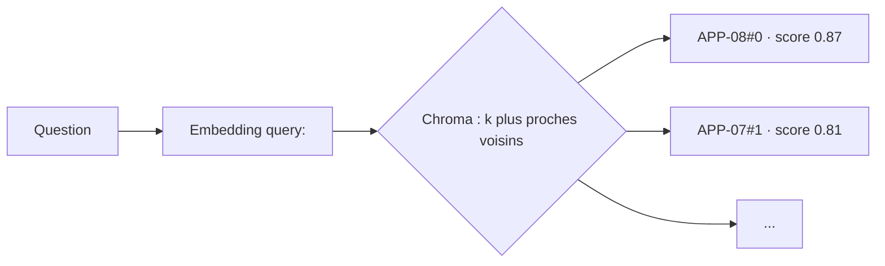

# Recherche vectorielle et vector store

## 1. L'idée en une phrase
On range les vecteurs de tous les morceaux de documents dans une base spécialisée, et pour
chaque question on récupère les k vecteurs les plus proches de celui de la question.

## 2. Explication simple
Reprenons la carte des embeddings : chaque morceau de document est une ville. Le vector
store, c'est l'annuaire de cette carte, organisé pour répondre très vite à la question
« quelles sont les 5 villes les plus proches de ce point ? ». Avec 80 villes on pourrait
mesurer toutes les distances à la main ; avec 10 millions, il faut un index malin.

## 3. Comment ça marche techniquement
- **Recherche exacte (force brute)** : calculer la similarité entre la question et chaque
  vecteur, trier, garder les k premiers. Coût proportionnel au nombre de vecteurs ;
  parfaitement adapté à quelques milliers de vecteurs.
- **Recherche approchée (ANN)** : au-delà, on accepte de rater parfois un voisin en échange
  d'une vitesse bien supérieure. Chroma utilise **HNSW** (*Hierarchical Navigable Small
  World*) : un graphe à plusieurs niveaux où chaque vecteur est relié à ses voisins ; on
  part d'un point d'entrée au niveau le plus grossier et on descend en se rapprochant de la
  question à chaque saut, comme on zoome sur une carte.
- **Distance** : cosinus, produit scalaire ou L2. Avec des vecteurs normalisés, les trois
  donnent le même classement.
- **Métadonnées** : à côté de chaque vecteur, la base stocke le texte et des métadonnées
  (id du document, catégorie...), ce qui permet de **filtrer** (« uniquement la catégorie
  compte ») et de **citer** la source.

## 4. Comment c'est implémenté dans ce projet
- `src/rag/ingestion.py` → `build_index()` : `Chroma.from_documents(...)` calcule les
  embeddings de tous les morceaux et les écrit dans `data/chroma/` (dossier ignoré par git,
  régénéré par `uv run python -m rag.ingestion`). Chaque morceau a un identifiant stable
  `<id_document>#<position>` (ex. `CPT-01#2`).
- `src/rag/config.py` : `CHROMA_DIR`, `COLLECTION_NAME`.
- La recherche elle-même (`similarity_search`) arrive en phase 2 dans `src/rag/retrieval.py`.
- `tests/test_ingestion.py::test_build_index_stores_chunks_with_metadata` vérifie que les
  morceaux sont stockés avec leurs identifiants et leurs métadonnées (avec de faux
  embeddings, pour ne tester que le stockage).

## 5. Choix faits et alternatives écartées
| Option | Pour | Contre |
|---|---|---|
| **Chroma, local persistant** (retenu) | Index sur disque, filtre par métadonnées natif, intégration LangChain, pas de serveur | Dépendances assez lourdes pour ~80 vecteurs |
| FAISS | Très rapide, léger | Pas de filtre natif par métadonnées ; sauvegarde LangChain via `pickle` (`allow_dangerous_deserialization`) |
| Matrice numpy + produit scalaire | 5 lignes de code, rien à installer | Tout à faire soi-même (persistance, filtres) |
| Qdrant / pgvector / Weaviate | Production, millions de vecteurs, multi-utilisateurs | Un serveur à faire tourner : disproportionné ici |

À ~80 morceaux, n'importe laquelle de ces options donne le même résultat : le choix de
Chroma porte sur la **simplicité d'usage** (persistance, filtres, API LangChain), pas sur
la performance. Passer à Qdrant ou pgvector deviendrait pertinent avec des millions de
documents ou plusieurs services qui partagent l'index.

## 6. Limites et pièges connus
- **Index périmé** : si un document change et qu'on oublie de ré-indexer, l'assistant
  répond avec l'ancienne version. Ici l'index est reconstruit de zéro à chaque ingestion.
- **Même modèle à l'indexation et à la recherche**, sinon les vecteurs ne sont pas comparables.
- **k fixe** : on renvoie toujours k résultats, même quand aucun n'est pertinent ; le score
  de similarité aide à détecter ce cas (utile pour le « je ne sais pas »).
- **Scores non comparables d'un modèle à l'autre** : un seuil « score > 0,8 » n'a de sens
  que pour un modèle donné, et se calibre sur le jeu de dev.
- HNSW est **approché** : négligeable à notre échelle, à surveiller à grande échelle.

## 7. Pour l'entretien
**30 secondes** : « Le vector store garde les embeddings des morceaux de documents avec
leurs métadonnées. À chaque question, on encode la question et on récupère les k voisins
les plus proches. J'utilise Chroma en local, parce qu'il persiste l'index sur disque et
filtre par catégorie ; à 80 vecteurs, le choix ne change rien à la performance. »

**2 minutes** : recherche exacte vs approchée, principe de HNSW (graphe à niveaux,
navigation gloutonne), rôle des métadonnées (citation, filtre), puis le tableau des
alternatives et le critère de passage à une base serveur (volume, partage entre services).

**Questions probables**
1. *Pourquoi une base vectorielle pour 80 vecteurs ?* → Pour la persistance et les filtres,
   pas pour la vitesse ; une matrice numpy ferait aussi bien, on l'assume.
2. *C'est quoi HNSW ?* → Graphe de voisinage multi-niveaux, recherche approchée en temps
   quasi logarithmique.
3. *Comment gérez-vous la mise à jour des documents ?* → Ré-indexation complète (secondes) ;
   à grande échelle, mise à jour incrémentale par identifiant de morceau.
4. *Et en production à 10 millions de documents ?* → Base serveur (Qdrant, pgvector),
   index approché réglé (compromis rappel / latence), filtrage par métadonnées.
