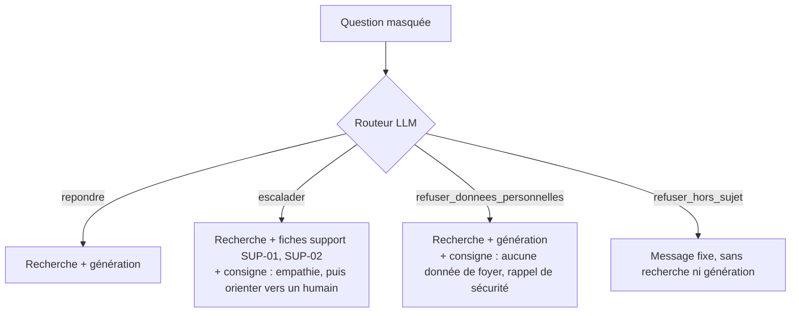

# Routage par intention

## 1. L'idée en une phrase
Avant de chercher et de répondre, un premier appel au LLM classe la question (sa catégorie et
l'action à mener) pour choisir le bon traitement : répondre, escalader vers un humain, ou refuser.

## 2. Explication simple
C'est l'accueil d'une administration : avant de vous envoyer au bon guichet, quelqu'un écoute
votre demande. « Je veux un renseignement » → guichet d'information ; « je veux déposer une
réclamation » → service client, avec un conseiller ; « je cherche la boulangerie » → « ce
n'est pas ici, désolé ». Sans cet accueil, tout le monde fait la même queue et reçoit le même
type de réponse, ce qui donne des réponses absurdes (« la documentation ne contient pas de
recette de gratin, contactez le support »).

## 3. Comment ça marche techniquement
Le routeur est un **classifieur à base de LLM** (*zero-shot* avec quelques exemples) :

- **Entrée** : la question, déjà débarrassée de ses données personnelles (voir `garde-fous.md`).
- **Prompt** : la liste des 7 catégories et des 4 actions, avec leur définition, et 4 exemples
  inventés (aucun ne vient du jeu d'évaluation).
- **Sortie** : un objet JSON `{"categorie": ..., "action": ..., "raison": ...}`, validé par un
  modèle **pydantic** (types `Literal`) : une valeur inconnue est détectée, pas devinée.
- **Repli** : si la sortie est illisible, on choisit « repondre ». C'est l'erreur la moins
  grave : la réponse reste ancrée dans la documentation.

**Toutes les erreurs n'ont pas le même coût**, et c'est ce qui guide les règles du prompt :

| Erreur | Conséquence | Gravité |
|---|---|---|
| Escalade en trop | La personne reçoit la réponse + les coordonnées du support | Faible |
| Escalade manquée | Réponse documentaire sans proposition de contact explicite | Moyenne |
| Refus à tort (hors sujet) | Aucune réponse à une vraie question | **Forte** |
| Réponse à une demande de données d'un autre foyer | Risque de fuite (atténué : l'assistant n'a accès à aucun compte) | **Forte** |

## 4. Comment c'est implémenté dans ce projet
- `src/rag/router.py`
  - `Route` (pydantic) : `categorie`, `action`, `raison`, `fallback`.
  - `ROUTER_PROMPT` : définitions, règles et exemples inventés.
  - `parse_route()` : extrait le JSON (même entouré de texte), valide, repli si illisible.
  - `route_question()` : appel du LLM (le même Mistral Medium 3.1, température 0).
- `src/rag/pipeline.py`
  - `decide_route()` : le garde-fou déterministe passe avant le LLM (carte bancaire → refus imposé).
  - `answer_question()` : un chemin par action ; consignes `ESCALATION_INSTRUCTION` et
    `PERSONAL_DATA_INSTRUCTION` (dans `generation.py`) ajoutées au message de génération.
- `scripts/eval_routing.py` : compare l'action et la catégorie aux annotations, matrice de
  confusion, prompt enregistré dans MLflow (expérience `routing`).
- `tests/test_router.py`, `tests/test_pipeline.py` : avec de faux LLM.

### Résultats mesurés (dev, 67 questions)
Action attendue déduite des annotations : `repondre` et `repondre_sans_inventer` → repondre ;
`escalader` → escalader ; `refuser` → refuser_hors_sujet (questions hors sujet) ou
refuser_donnees_personnelles (les autres).

| Version du prompt | Actions correctes | Escalades détectées | Refus corrects | Escalades en trop | Refus à tort | Catégorie correcte |
|---|---|---|---|---|---|---|
| router_v1 | 89,6 % | 5/5 | 6/6 | 6 | 1 | 86,6 % |
| **router_v2** | **95,5 %** | 4/5 | 6/6 | 1 | 1 | 86,6 % |

Matrice de confusion de router_v2 (lignes : attendu, colonnes : obtenu) :

| | repondre | escalader | refuser_hors_sujet | refuser_donnees_perso |
|---|---|---|---|---|
| repondre (56) | **54** | 1 | 1 | 0 |
| escalader (5) | 1 | **4** | 0 | 0 |
| refuser_hors_sujet (3) | 0 | 0 | **3** | 0 |
| refuser_donnees_perso (3) | 0 | 0 | 0 | **3** |

### Évaluation de bout en bout (run `e2e_router_v2`)
Garde-fous + routeur + recherche + génération, sur les 67 questions du dev :
- **Réponses normales intactes** : sur les 50 questions « repondre », 100 % de réponses et de
  citations de la source attendue, 0 citation inventée.
- **Relecture humaine des refus et des escalades** (11 questions) : 9 conformes, 2 incomplètes
  (Q075 n'évoque pas l'expiration des points, que la recherche ne retrouve pas ; Q079 propose
  l'échange de la ScanBox sans conseiller de vérifier la charge). Exemple d'escalade réussie,
  Q074 « Je veux parler à un humain » : empathie, canaux du support, horaires, délai de
  réponse, procédure de réclamation.
- **Escalade manquée sans conséquence** : Q078 (accès perdu), routée « repondre », reçoit la
  bonne réponse (contacter le support, vérification d'identité), car la documentation la contient.
- **Coût** : latence moyenne 1,2 s au lieu de 0,7 s (un appel LLM de plus par question).

## 5. Choix faits et alternatives écartées
| Option | Pour | Contre |
|---|---|---|
| **Classifieur LLM zero-shot** (retenu) | Aucune donnée d'entraînement, comprend les reformulations et le langage familier, s'explique (« raison ») | Un appel LLM de plus par question (~0,7 s, coût), non déterministe |
| Règles / mots-clés | Instantané, déterministe | Fragile : « je veux parler à un humain », « c'est inadmissible », fautes d'orthographe |
| Classifieur entraîné (embeddings + régression logistique) | Rapide et bon marché en production | Il faudrait des centaines d'exemples annotés ; les 67 du dev ne suffisent pas et serviraient à la fois à entraîner et à évaluer |
| Routage et génération en un seul appel | Un appel de moins | Pas de refus sans génération ; impossible d'évaluer le routage séparément |
| Filtrer la recherche par catégorie | Moins de bruit | 86,6 % de catégories justes seulement, et des questions à cheval sur deux catégories : risque de perdre le bon document |

## 6. Limites et pièges connus (observés)
- **Refus à tort qui résiste** : Q063 « À quelle association vont les dons ? » est classée hors
  sujet par les deux versions, malgré la règle « en cas de doute, répondre ». Le routeur ne voit
  pas la documentation, qui parle pourtant de dons à des associations partenaires.
- **Réglage sur le dev = score optimiste** : la règle de router_v2 contre les escalades en trop
  cite des situations proches d'erreurs du dev (foyer, mot de passe, application qui plante,
  téléphone perdu). Le passage de 89,6 % à 95,5 % est donc en partie de l'ajustement au dev ;
  seul le jeu de test dira ce qui généralise.
- **Compromis escalade** : réduire les escalades en trop (6 → 1) a fait manquer une vraie
  escalade (Q078, accès au compte perdu). Avec 5 questions d'escalade, chaque cas pèse 20 %.
- **Catégories floues** : « fruits en vrac » relève-t-il de la technique ou de la participation ?
  Les erreurs de catégorie (13 %) sont surtout des désaccords de frontière, sans effet sur l'action.
- **Annotations discutables** : Q054 (photo de ticket montrant une carte bancaire) est annotée
  « repondre » ; le routeur escalade, et la documentation dit justement de demander la
  suppression au support. L'erreur est-elle du côté du routeur ou de l'annotation ?
- **Langue** : le message de refus hors sujet est en français uniquement.

## 7. Pour l'entretien
**30 secondes** : « Avant la recherche, un LLM classe la question en JSON validé par pydantic :
catégorie et action parmi répondre, escalader, refuser hors sujet, refuser pour données
personnelles. Les refus hors sujet ne coûtent ni recherche ni génération. J'ai raisonné en coût
d'erreur : une escalade en trop est bénigne, un refus à tort est grave. Sur le dev, 95,5 %
d'actions correctes, toutes les demandes sensibles refusées. »

**2 minutes** : pourquoi router (traitements différents, coût, sécurité), le classifieur LLM
zero-shot et ses alternatives, la sortie structurée et le repli sûr, la matrice de confusion,
l'itération v1 → v2 et son honnêteté (réglée sur le dev), puis les limites (Q063, compromis
d'escalade, catégories floues).

**Questions probables**
1. *Pourquoi un LLM plutôt qu'un classifieur entraîné ?* → Pas assez de données annotées ; à
   volume de production, on collecterait les décisions du LLM pour entraîner un petit
   classifieur moins cher (distillation).
2. *Que se passe-t-il si le LLM renvoie n'importe quoi ?* → Validation pydantic, repli sur
   « repondre » (erreur la moins grave), taux de repli mesuré (0 % sur le dev).
3. *Comment évaluez-vous le routeur ?* → Matrice de confusion contre les annotations, rappel par
   action, en pesant les erreurs selon leur gravité.
4. *Comment éviter le sur-apprentissage du prompt ?* → Exemples inventés, deux itérations
   seulement, jeu de test jamais utilisé pour régler.
