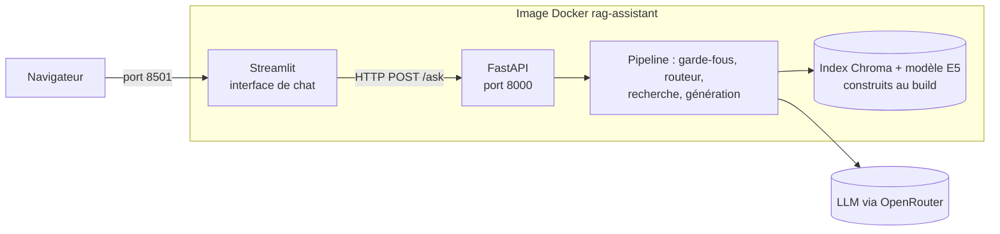

# Mise en service : API, interface et conteneur

## 1. L'idée en une phrase
On emballe le pipeline dans une **API HTTP** (que n'importe quel client peut appeler), on lui
donne une **interface de chat**, et on fige le tout dans une **image Docker** qui tourne à
l'identique partout.

## 2. Explication simple
Jusqu'ici, l'assistant n'existait que sous forme de scripts lancés à la main. Pour le servir :
- **l'API** est le guichet : on lui envoie une question, elle renvoie une réponse au format JSON.
  Une application mobile, un site ou un outil interne pourraient tous l'utiliser ;
- **l'interface Streamlit** est une vitrine posée devant ce guichet, pour les humains ;
- **l'image Docker** est un conteneur scellé : système, Python, dépendances, modèle et index
  sont dedans. « Ça marche sur ma machine » devient « ça marche partout où Docker tourne ».

## 3. Comment ça marche techniquement

**API (FastAPI)** :
- `POST /ask` : corps `{"question": "..."}` validé par **pydantic** (1 à 1 000 caractères, sinon
  erreur 422) ; réponse `{answer, action, category, sources, not_in_docs, latency_ms}`.
- `GET /health` : vérification de disponibilité, utilisée par Docker pour savoir quand l'API est prête.
- **Chargement unique au démarrage** (*lifespan*) : modèle d'embeddings, index et client LLM sont
  chargés une fois, pas à chaque requête.
- **Point de terminaison synchrone** (`def`, pas `async def`) : le pipeline fait des appels
  bloquants ; FastAPI l'exécute dans un pool de threads sans bloquer les autres requêtes.
- **Erreurs** : panne du LLM → 503 avec un message neutre ; le détail (qui pourrait contenir une
  clé ou une donnée) n'est ni renvoyé ni journalisé, seul le type d'erreur l'est.

**Docker** :
- Image `python:3.12-slim` + `uv` ; installation exacte depuis `uv.lock` (`--locked`), torch en
  version CPU (pas de CUDA).
- **Couches ordonnées pour le cache** : dépendances d'abord (longues, changent rarement), code
  ensuite (court, change souvent) : modifier le code ne réinstalle pas torch.
- **Modèle et index construits pendant le build** : le conteneur démarre sans rien télécharger.
- **Utilisateur non-root** (uid 1000).
- **Aucun secret dans l'image** : `.env` est exclu par `.dockerignore` ; la clé est fournie au
  lancement par `docker compose` (`env_file`).
- **Compose** : deux services (`api`, `ui`) depuis la même image ; l'interface attend que l'API
  soit déclarée saine (*healthcheck*) avant de démarrer.

## 4. Comment c'est implémenté dans ce projet
- `src/rag/api.py` : `AskRequest`, `AskResponse`, `Source` (pydantic), `lifespan`, `/health`, `/ask`.
- `app/api_client.py` : `ask_api()` (appel HTTP, erreurs transformées en messages lisibles),
  `format_sources()`, `ACTION_LABELS` (bandeaux escalade / refus).
- `app/streamlit_app.py` : historique de conversation (`st.session_state`), questions d'exemple,
  sources dépliables, mention « données fictives ».
- `src/rag/config.py` : `MAX_QUESTION_CHARS`, `API_URL`.
- `Dockerfile`, `.dockerignore`, `docker-compose.yml`.
- Tests sans LLM :
  - `tests/test_api.py` : réponse et sources (une citation inventée n'est pas montrée comme
    source), validation des questions (422), panne du pipeline (503 sans fuite de détails) ;
  - `tests/test_api_client.py` : client HTTP avec transport simulé (`httpx.MockTransport`),
    API injoignable, et rendu de la page Streamlit (`AppTest`).

**Mesuré en local (hors Docker)** : démarrage de l'API ≈ 42 s (chargement du modèle et de
l'index), première réponse en 2,7 s ; la question contenant un numéro de carte est refusée par
le garde-fou, sans que le numéro soit répété.

**Mesuré avec Docker Compose** :
- Image : **6,97 Go** au premier build, ramenée à **4,08 Go** par deux corrections : le cache de
  téléchargement de uv restait dans l'image (~2 Go, désormais monté pendant le build seulement),
  et MLflow avec ses dépendances (pyarrow, pandas, scikit-learn…) a été déplacé vers les
  dépendances de développement, inutiles au service. Restent surtout torch CPU (768 Mo), le
  modèle d'embeddings (~470 Mo), LangChain, Chroma, Streamlit.
- Build complet : 284 s. API déclarée saine ~43 s après son démarrage.
- « Je veux parler à un humain » → escalade, sources SUP-01 et SUP-02, 2,9 s ; « une recette de
  gratin » → refus hors sujet, 0,9 s (ni recherche ni génération).
- `HF_HUB_OFFLINE=1` : sans ce réglage, le conteneur interrogeait le Hub Hugging Face à chaque
  démarrage alors que le modèle est déjà dans l'image.

## 5. Choix faits et alternatives écartées
| Choix | Alternative | Pourquoi |
|---|---|---|
| Interface qui appelle l'API par HTTP | Interface qui importe directement le pipeline | Architecture réaliste (l'API sert d'autres clients), interface légère, chaque partie testable séparément ; au prix d'un saut réseau |
| FastAPI | Flask (exclu par la consigne), Django | Validation pydantic native, documentation interactive (`/docs`), asynchrone si besoin |
| Une image pour les deux services | Deux images | Un seul build ; l'interface n'a pas besoin de plus |
| Index construit au build | Index construit au démarrage | Démarrage plus rapide et image autonome ; au prix d'une image plus lourde et d'un rebuild si le corpus change |
| Chargement au démarrage (lifespan) | Chargement par requête | Plusieurs secondes gagnées par question |

## 6. Limites et pièges connus
- **Pas d'authentification ni de limitation de débit** : n'importe qui ayant l'adresse peut
  appeler l'API et consommer des crédits LLM. Indispensable avant une vraie mise en ligne
  publique (clé d'API, quota par adresse IP).
- **Un seul processus** : les requêtes simultanées partagent un pool de threads ; suffisant pour
  une démo, pas pour une charge réelle (plusieurs workers, mise à l'échelle horizontale).
- **Historique non transmis au LLM** : chaque question est traitée seule ; « et pour les cartes
  physiques ? » après une question sur les cartes cadeaux ne sera pas compris.
- **Corpus figé dans l'image** : modifier un document impose de reconstruire l'image.
- **Ports 8000 et 8501 occupés sur le poste de développement** (relais WSL) : l'API est exposée
  sur 8010 et l'interface sur 8510 en local. Piège rencontré : un « HTTP 200 » sur 8501 venait
  d'un autre programme, pas du conteneur.
- **Image lourde (4 Go)** : torch et le modèle dominent ; un modèle d'embeddings servi par API, ou
  un export ONNX sans torch, la réduirait fortement.

## 7. Pour l'entretien
**30 secondes** : « Le pipeline est exposé par une API FastAPI : validation pydantic des
entrées, chargement unique du modèle au démarrage, erreurs propres sans fuite de détails.
L'interface Streamlit appelle cette API par HTTP. Le tout tient dans une image Docker
reproductible, avec le modèle et l'index construits au build, un utilisateur non-root et
aucun secret dans l'image. »

**2 minutes** : le contrat de l'API (entrée, sortie, codes d'erreur), le lifespan et le choix
synchrone, la séparation interface / API, la construction de l'image (cache des couches, torch
CPU, index au build, non-root, secrets au lancement), Compose et le healthcheck, puis ce qui
manque pour la production (authentification, quotas, workers, historique de conversation).

**Questions probables**
1. *Pourquoi charger le modèle dans le lifespan ?* → Une fois au démarrage au lieu de quelques
   secondes à chaque requête.
2. *`async def` ou `def` ?* → `def`, car le pipeline est bloquant ; en `async def`, un appel
   bloquant gèlerait toute l'API.
3. *Comment gérez-vous les secrets ?* → Jamais dans le code ni dans l'image : `.env` en local,
   variables d'environnement au lancement, secrets GitHub en CI.
4. *Qu'ajouteriez-vous pour la production ?* → Authentification, limitation de débit,
   plusieurs workers, journaux structurés et métriques (latence, taux d'escalade), suivi des coûts LLM.
